<div align="center">
  <h1>Polaris</h1>
  <h3>Your home lab, one control plane.</h3>
  
  
  
  <br />
  <br />
  <a href="#if-you-already-pay-for-these">Why</a>
  <span>&nbsp;&nbsp;•&nbsp;&nbsp;</span>
  <a href="#install">Install</a>
  <span>&nbsp;&nbsp;•&nbsp;&nbsp;</span>
  <a href="#whats-in-it">What's in it</a>
  <span>&nbsp;&nbsp;•&nbsp;&nbsp;</span>
  <a href="#everything-connects">Integrations</a>
  <span>&nbsp;&nbsp;•&nbsp;&nbsp;</span>
  <a href="#usage">Usage</a>
  <span>&nbsp;&nbsp;•&nbsp;&nbsp;</span>
  <a href="docs/developers/README.md">Developers</a>
  <span>&nbsp;&nbsp;•&nbsp;&nbsp;</span>
  <a href="README.es.md">Español</a>
  <hr />
</div>

Polaris is a self-hosted platform to run your servers and your team from one
place: deploy apps and databases to your own machines, manage files across every
NAS and cloud drive, host game servers, and work together with chat, calls,
tasks, calendar, mail and documents.

It replaces the separate tools a home lab or a small team ends up running -
deployments, file sharing, a password manager, uptime checks, analytics, chat, a
task tracker - with one install and one set of accounts. The apps share data: a
task links the deploy it is about, and a file in Drive attaches to a message
without being uploaded again.

It runs in Docker and manages the host it is installed on plus any machine you
add over SSH. After the install, updates and settings are handled from the web
interface.

## What's in it

Screenshots of the real interface with sample data. Mobile versions are in
[docs/assets/media](docs/assets/media). Each app is enabled per account and per role.

### Talk

#### Chat

Spaces, channels, threads and direct messages. [Full feature list](docs/features/chat.md).

<a href="docs/features/chat.md">
<picture>
  <source media="(prefers-color-scheme: light)" srcset="docs/assets/media/chat-light-en-desktop.webp">
  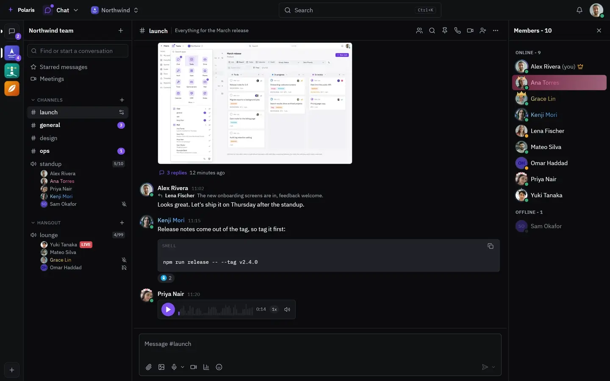
</picture>
</a>

- Servers and channels, direct messages and groups.
- Voice messages, screen clips and scheduled messages.

#### Calls

Voice channels, meetings and calls in any chat. [Full feature list](docs/features/calls.md).

<a href="docs/features/calls.md">
<picture>
  <source media="(prefers-color-scheme: light)" srcset="docs/assets/media/in-call-light-en-desktop.webp">
  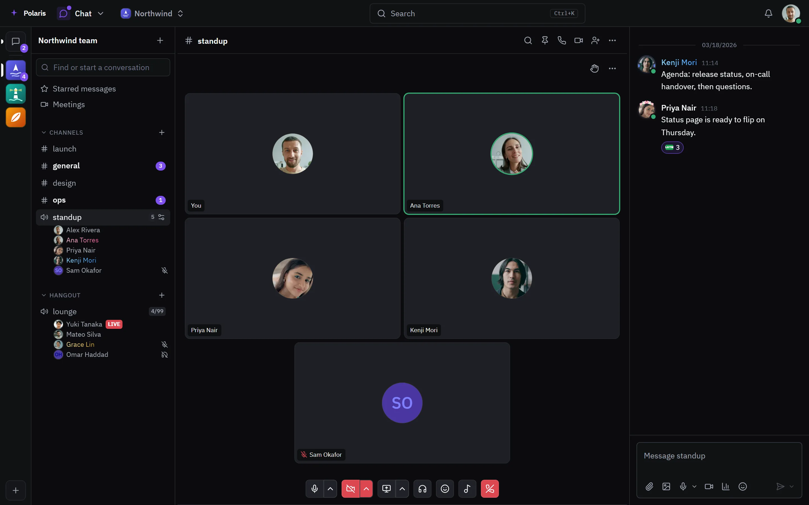
</picture>
</a>

<table>
  <tr>
    <td width="50%" valign="top">
      <a href="docs/features/calls.md">
      <picture>
        <source media="(prefers-color-scheme: light)" srcset="docs/assets/media/call-direct-light-en-desktop.webp">
        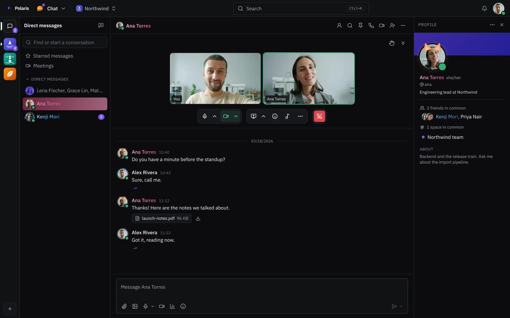
      </picture>
      </a>
      <br><sub><b>Direct call</b>: face to face from any direct message</sub>
    </td>
    <td width="50%" valign="top">
      <a href="docs/features/calls.md">
      <picture>
        <source media="(prefers-color-scheme: light)" srcset="docs/assets/media/call-group-light-en-desktop.webp">
        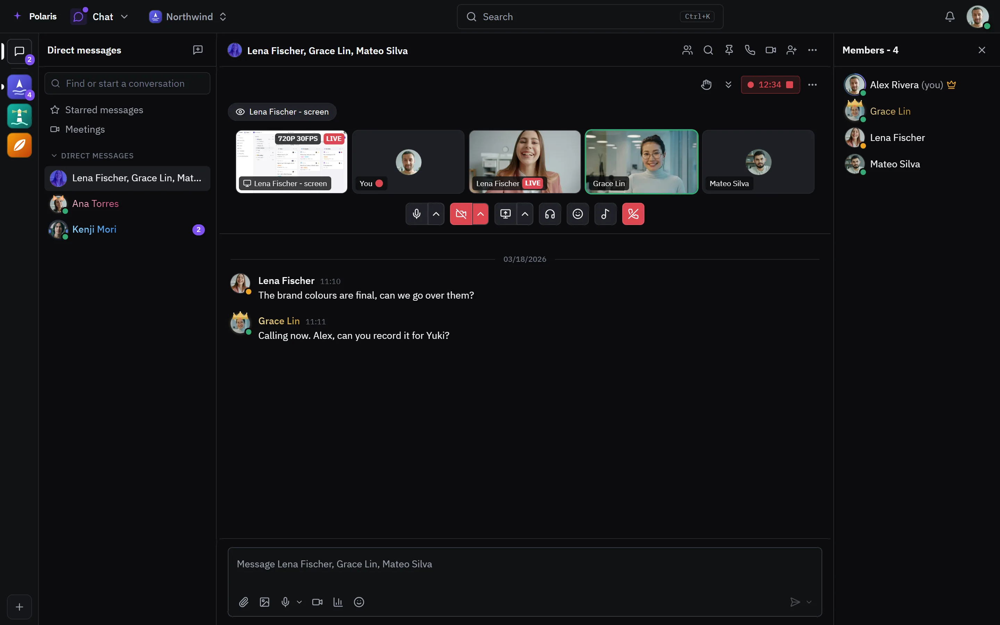
      </picture>
      </a>
      <br><sub><b>Group call</b>: cameras, a shared screen and a recording</sub>
    </td>
  </tr>
</table>

<a href="docs/features/calls.md">
<picture>
  <source media="(prefers-color-scheme: light)" srcset="docs/assets/media/soundboard-light-en-desktop.webp">
  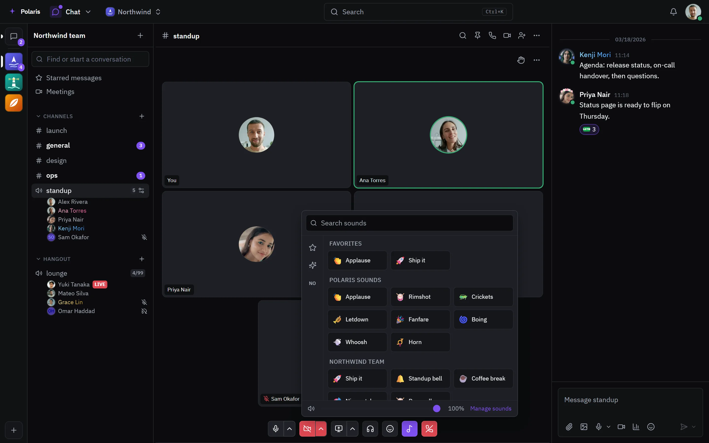
</picture>
</a>

<sub><b>Soundboard</b>: Polaris's own sounds and the space's, played into the call</sub>

- Calls and meetings from any channel or direct message.
- Screen sharing and recording.
- A soundboard with Polaris's own sounds and the space's.

#### Inbox

Telegram, WhatsApp, Discord and Slack conversations in one place.

### Work

#### Tasks

Lists, boards, sprints and goals. [Full feature list](docs/features/tasks.md).

<a href="docs/features/tasks.md">
<picture>
  <source media="(prefers-color-scheme: light)" srcset="docs/assets/media/tasks-light-en-desktop.webp">
  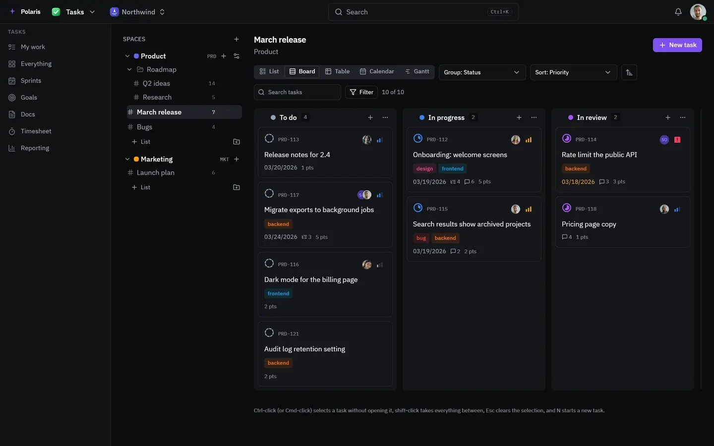
</picture>
</a>

- Spaces, lists, boards, sprints, goals and docs.
- Custom fields, automations, forms and time tracking.

#### Calendar

Every calendar you have, synced both ways. [Full feature list](docs/features/calendar.md).

<a href="docs/features/calendar.md">
<picture>
  <source media="(prefers-color-scheme: light)" srcset="docs/assets/media/calendar-light-en-desktop.webp">
  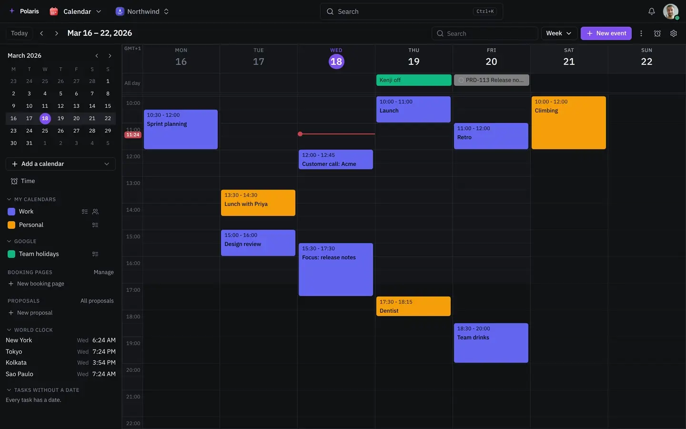
</picture>
</a>

- Day, week, month and year views.
- Sharing and public links.
- Two-way sync with Google, Microsoft 365 and any CalDAV server or ICS feed.
- Reminders, invitations, free/busy and meeting rooms.
- Booking pages other people can reserve a slot on.
- A Time area with alarms, timers, focus cycles, a stopwatch and a world clock.

#### Mail

Every mailbox in one inbox. [Full feature list](docs/features/mail.md).

<a href="docs/features/mail.md">
<picture>
  <source media="(prefers-color-scheme: light)" srcset="docs/assets/media/mail-light-en-desktop.webp">
  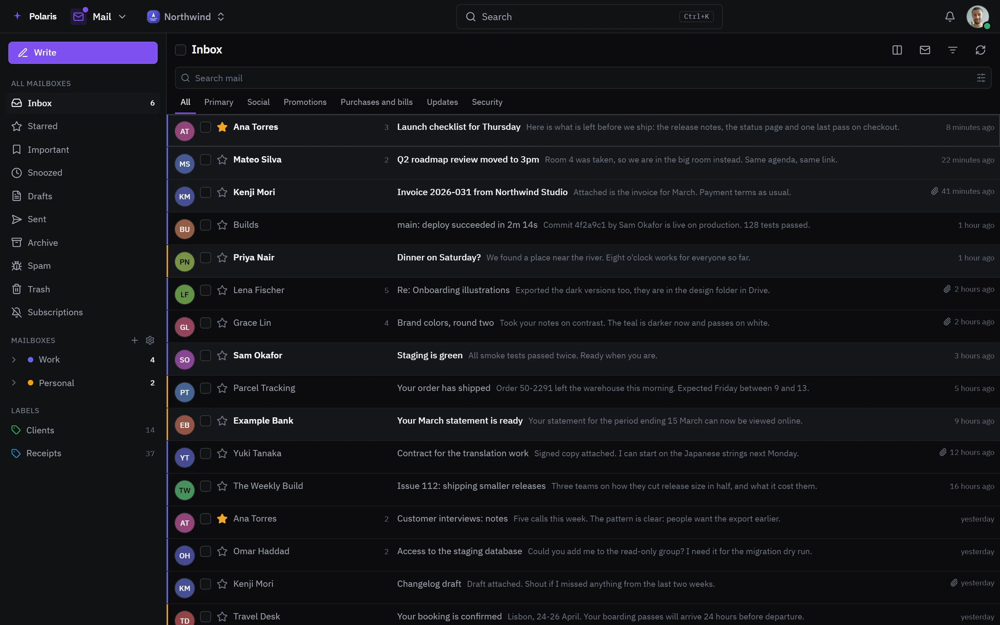
</picture>
</a>

#### Office

Documents, sheets, slides and diagrams. [Full feature list](docs/features/office.md).

<a href="docs/features/office.md">
<picture>
  <source media="(prefers-color-scheme: light)" srcset="docs/assets/media/office-light-en-desktop.webp">
  
</picture>
</a>

#### Notes

Nested notes.

- Imports an Obsidian vault or a folder of Markdown.

#### Organizations

Teams with their own members and roles.

### Files and secrets

#### Drive

Your drive and every storage you own. [Full feature list](docs/features/drive.md).

<a href="docs/features/drive.md">
<picture>
  <source media="(prefers-color-scheme: light)" srcset="docs/assets/media/drive-light-en-desktop.webp">
  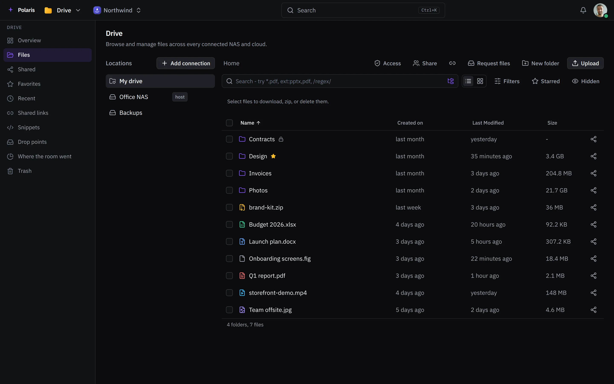
</picture>
</a>

- A private drive per account and a shared one per organization.
- Local disks, SFTP, S3-compatible storage, SMB/NFS, UniFi UNAS, Google Drive, OneDrive and Dropbox (WebDAV, Synology, QNAP and TrueNAS are coming).
- Streaming transfers for large files.
- Sharing with people and groups by role and expiry; public links with password and expiry.
- Drop points for people without an account.
- Viewers and editors for documents, spreadsheets, PDFs and media; thumbnails in the grid.

#### Vault

Passwords and one-time codes, Bitwarden compatible. [Full feature list](docs/features/vault.md).

<a href="docs/features/vault.md">
<picture>
  <source media="(prefers-color-scheme: light)" srcset="docs/assets/media/vault-light-en-desktop.webp">
  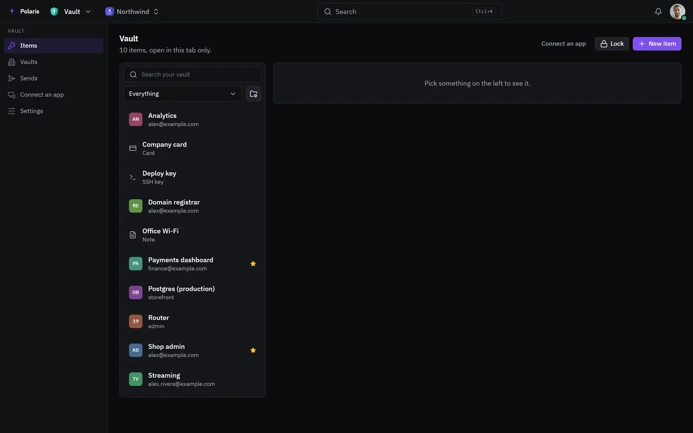
</picture>
</a>

- Works with the Bitwarden apps and extensions.
- Encrypted in the browser; the server never sees the master password.

### Running things

#### Deploy

Apps, databases and domains on your machines. [Full feature list](docs/features/deploy.md).

<a href="docs/features/deploy.md">
<picture>
  <source media="(prefers-color-scheme: light)" srcset="docs/assets/media/deploy-project-light-en-desktop.webp">
  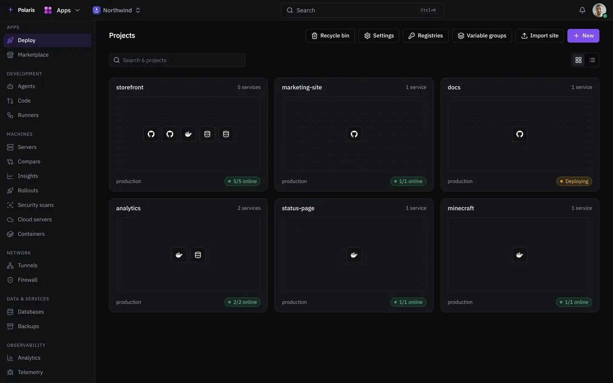
</picture>
</a>

- Deploy an app from a Git repository or an image.
- Databases, volumes, environment variables, logs, a terminal, a file browser and a domain.
- Public access through your own domain, a Cloudflare tunnel or DuckDNS.

#### Marketplace

Apps installed with one press. [Full feature list](docs/features/marketplace.md).

<a href="docs/features/marketplace.md">
<picture>
  <source media="(prefers-color-scheme: light)" srcset="docs/assets/media/marketplace-light-en-desktop.webp">
  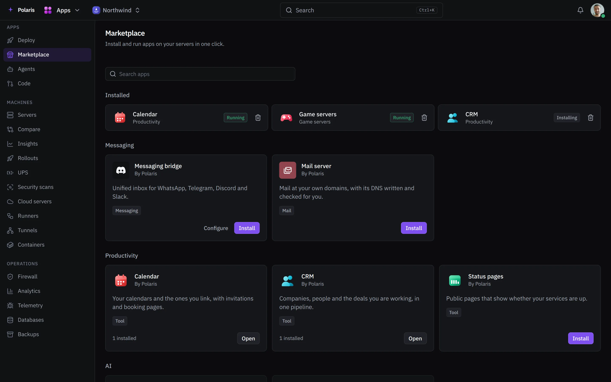
</picture>
</a>

- One-click installs of self-hosted apps.

#### Game servers

Minecraft, ARK and FiveM on your own machines. [Full feature list](docs/features/game-servers.md).

<a href="docs/features/game-servers.md">
<picture>
  <source media="(prefers-color-scheme: light)" srcset="docs/assets/media/games-light-en-desktop.webp">
  
</picture>
</a>

- Worlds, mods, resources, players, schedules and crash detection.
- Minecraft challenges: daily, weekly, season pass, bingo and community goals.
- Worlds can live on a NAS.

#### Servers

Enrol a machine over SSH with one generated command.

- Its terminal, files, metrics and Docker engine from here.

#### Containers and Backups

What is running on every host, and scheduled backups of it with restore.

#### Runners

GitHub Actions compatible CI on your own machines.

- Per-repo policy and budgets.

#### Agents

Coding agents on your repositories.

- Headless runs that open pull requests and answer reviews with your own model keys.
- Live sessions of Claude Code, Codex and other CLIs in a terminal you can watch and steer.
- A task can be assigned to an agent, which updates it through Polaris's MCP server.

#### Code

The pull requests and issues you have open on GitHub, read as you.

#### Databases

Postgres, MySQL, MariaDB, MongoDB and Redis.

- Browse, query and back up what you deployed.
- Connect to one elsewhere, directly or through an SSH tunnel, via a registered server or a login typed into the connection.

### Keeping an eye on it

#### Watch

Alerts on app health, spikes and outages.

- Webhooks for every alert.
- Uptime history and a 90-day heatmap.

#### Analytics

Cookieless web analytics for the sites you host.

#### Firewall

A rule per protection.

- Allow and deny lists, country and network rules.
- Bot and scraper defences, injection scanning, and automatic bans.

#### Domain security

Every domain Polaris knows, audited daily.

- Spoofable mail: SPF, DKIM, DMARC, MTA-STS.
- DNS exposure: DNSSEC, CAA, open zone transfers, dangling records.
- Registration: expiry, transfer lock.
- Web hardening: TLS, HSTS, security headers.
- One-click fixes where Polaris manages the domain, and an alert when the daily check finds a regression.

#### Places

Cameras and device controls for each place.

<picture>
  <source media="(prefers-color-scheme: light)" srcset="docs/assets/media/places-light-en-desktop.webp">
  
</picture>

- Live views, clips, detections and alerts delivered as messages.
- Switches, plugs, lights, locks, air conditioners and purifiers from Tuya, TP-Link, Shelly, Hue, IKEA, Gree, Philips (Air+, HomeID and Dynalite), Home Assistant and SwitchBot.
- Automations across all of them.
- An alert when a camera goes offline.

### Getting around

#### App launcher

Every app, and what is waiting in each. [Full feature list](docs/features/launcher.md).

<a href="docs/features/launcher.md">
<picture>
  <source media="(prefers-color-scheme: light)" srcset="docs/assets/media/launcher-light-en-desktop.webp">
  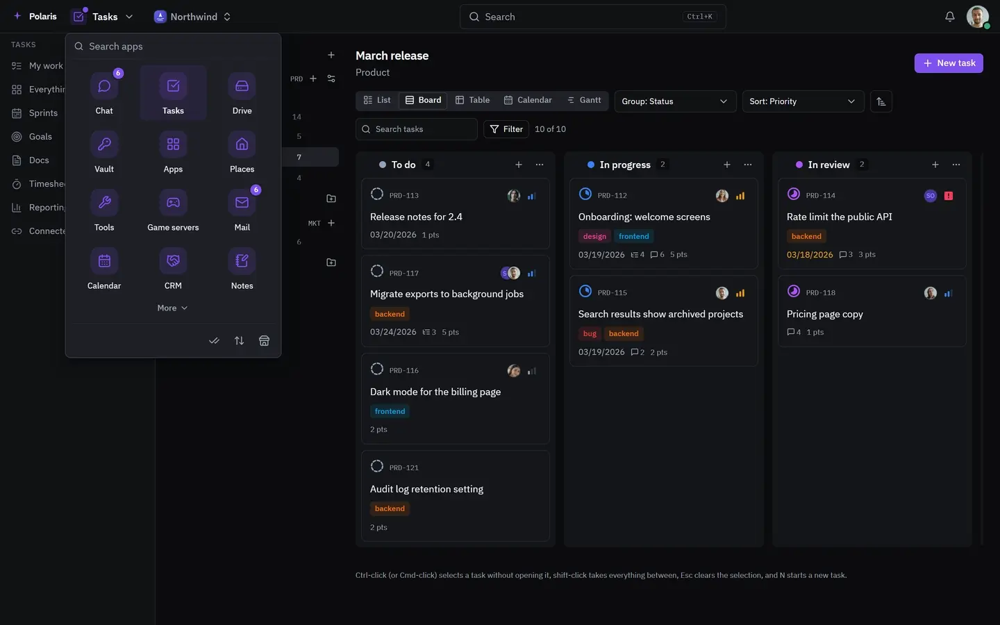
</picture>
</a>

#### Settings

The deployment's, and your own account's. [Full feature list](docs/features/settings.md).

<a href="docs/features/settings.md">
<picture>
  <source media="(prefers-color-scheme: light)" srcset="docs/assets/media/settings-light-en-desktop.webp">
  
</picture>
</a>

<a href="docs/features/settings.md">
<picture>
  <source media="(prefers-color-scheme: light)" srcset="docs/assets/media/settings-users-light-en-desktop.webp">
  
</picture>
</a>

- People and access: who is in, their roles and what limits them.

#### The account itself

Passwords, passkeys, two-factor, trusted devices, QR sign-in from another device,
sessions, API keys, access rules, privacy and notification settings. Claude,
ChatGPT, Cursor, VS Code and any other MCP client can connect as you, limited to
what you approve - see
[`docs/connecting-ai-assistants.md`](docs/connecting-ai-assistants.md).

What is built versus in progress is tracked in
[`dashboard/ROADMAP.md`](dashboard/ROADMAP.md).

## If you already pay for these

What Polaris replaces, on your own hardware and with one account:

| What you use today                 | What Polaris runs instead                                                                                                                                                           |
| ---------------------------------- | ----------------------------------------------------------------------------------------------------------------------------------------------------------------------------------- |
| Railway, Render, Fly               | Deploy from a repository or an image - onto their servers or onto your own machines                                                                                                 |
| Discord, Slack, WhatsApp, Telegram | One chat: channels and servers, direct messages, calls, meetings, voice notes, screen clips                                                                                         |
| GitHub Actions                     | The same workflows on your own runners, so a private repository costs no minutes                                                                                                    |
| CodeRabbit                         | Reviews and coding agents that run here, on your own model keys                                                                                                                     |
| Pterodactyl and a pile of scripts  | Game servers - Minecraft, ARK and FiveM - with worlds, mods, resources, players and schedules                                                                                       |
| ClickUp, Jira, Linear              | Spaces, lists, boards, sprints, goals, docs and time tracking - or connect your existing Linear or Jira and keep its issues mirrored in, with status pushed back                    |
| Google Calendar, Proton Calendar   | Day to year views, sharing and public links, two-way sync with Google, Microsoft and any CalDAV server, reminders, invitations and booking pages other people can reserve a slot on |
| Home Assistant, a camera app       | Places: cameras with live views, detections, clips and alerts, plus switches, plugs, lights, locks, air conditioners and purifiers from a dozen brands, with automations            |
| Your NAS vendor's web UI           | One file browser across every NAS you own, with sharing and drop points                                                                                                             |
| Bitwarden, 1Password               | A vault your existing Bitwarden apps can point at, encrypted in the browser                                                                                                         |
| Cloudflare's dashboard             | A firewall of your own: rules, country and network blocks, bot defences, bans                                                                                                       |
| A backup tool and a database GUI   | Scheduled backups with restore, and Postgres, MySQL, MariaDB, MongoDB and Redis                                                                                                     |
| Google Analytics, Plausible        | Cookieless analytics for the sites you host                                                                                                                                         |

## Install

One command installs the dashboard, database, reverse proxy and host daemon,
and generates the secrets:

```bash
# macOS / Linux
curl -fsSL https://raw.githubusercontent.com/FJRG2007/polaris/main/dashboard/scripts/install.sh | sh

# Windows (PowerShell)
irm https://raw.githubusercontent.com/FJRG2007/polaris/main/dashboard/scripts/install.ps1 | iex
```

Linux is the recommended host - Ubuntu Server is what Polaris is run against.
Windows works, but Docker there runs inside WSL and the host Polaris manages is
that virtual machine rather than the machine itself; see
[Requirements](#requirements).

Prefer to do it by hand? Clone the repo and run Compose directly:

```bash
git clone https://github.com/FJRG2007/polaris.git
cd polaris/dashboard/docker
cp .env.example .env                  # then replace every REPLACE_ME value in it
docker network create polaris-proxy   # compose expects both to exist already
docker network create polaris-hub
docker compose --profile full up -d
```

Then open `https://127.0.0.1/oauth/setup?token=` followed by the
`POLARIS_SETUP_TOKEN` you put in `.env`, and create the administrator. The
certificate is self-signed until a domain points here, so the browser warns once.

To update, use the Update button in Settings.

## Where it runs

The interface is in English and Spanish ([en español](README.es.md)), and each account picks its own.

| Client                                                                        | Status                                                                           |
| ----------------------------------------------------------------------------- | -------------------------------------------------------------------------------- |
| Web app, installable from the browser                                         | Available                                                                        |
| Browser extension for Chrome and Firefox: fills sign-in forms from your vault | Available ([releases](https://github.com/FJRG2007/polaris/releases?q=extension)) |
| MCP server for Claude, ChatGPT, Cursor, VS Code and other AI clients          | Available ([setup](docs/connecting-ai-assistants.md))                            |
| Developer CLI (`plr`): deploy, logs, restarts                                 | Coming: in the repo, not released yet                                            |
| Desktop app for Windows, macOS and Linux                                      | Coming: in the repo, not released yet                                            |
| iOS and Android apps                                                          | Coming                                                                           |

## Everything connects

The services Polaris already talks to. Each one is switched on from the interface.

|                                                                                                                                                                                                                                                                                                                                                                                                                                                                                                                                                                                                                                                                                                                                                                                                                                                                                                                                                                                       |                                                                                                                                                          |
| ------------------------------------------------------------------------------------------------------------------------------------------------------------------------------------------------------------------------------------------------------------------------------------------------------------------------------------------------------------------------------------------------------------------------------------------------------------------------------------------------------------------------------------------------------------------------------------------------------------------------------------------------------------------------------------------------------------------------------------------------------------------------------------------------------------------------------------------------------------------------------------------------------------------------------------------------------------------------------------- | -------------------------------------------------------------------------------------------------------------------------------------------------------- |
|                                                                                                                                                                                                                                                                                                                                                                                                                                                                                                                                                                                                                                                                                                                                                                                                                                                                                            | **Google**: sign in, two-way Calendar and Tasks sync, Gmail as a mailbox, Google Drive as storage, Docs and Sheets imported into Office                  |
|                                                                                                                                                                                                                                                                                                                                                                                                                                                                                                                                                                                                                                                                                                                                                                                                                                                                                   | **Microsoft 365**: Outlook calendar sync, Outlook mail, OneDrive as storage                                                                              |
|                                                                                                                                                                                                                                                                                                                                                                                                                                                                                                                                                                                                                                                                                                                                                                         | **GitHub**: sign in, deploy repositories, run Actions on your own runners, read pull requests and issues                                                 |
|                                                                                                                                                                                                                                                                                                                                                                                                                                                                                                                                                                                                                                                                                                                                                                                                       | **Linear and Jira**: issues mirrored into Tasks, status pushed back                                                                                      |
|                                                                                                                                                                                                                                                                                                                                                                                                                                                                                                                                                                                                                                                                                                                                                                                        | **CalDAV**: iCloud, Nextcloud, Fastmail, Yahoo or any CalDAV server, plus ICS feeds                                                                      |
|                                                                                                                                                                                                                                                                                                                                                                                                                                                                                                                                                                                               | **Inbox**: conversations from Telegram, WhatsApp, Discord and Slack in one place                                                                         |
|                                                                                                                                                                                                                                                                                                                                                                                                                                                                                                                                                                                                                                                                                 | **Storage and hosts**: Dropbox, UniFi UNAS, S3, SFTP, SMB and NFS in Drive; the Docker engine of every server you enrol                                  |
|                                                                                                                                                                                                                                                                                                                                                                                                                                                                                                                                                                                                                                                                                                            | **Deploy elsewhere**: Vercel, Railway and AWS (ECS, Amplify) projects next to your own                                                                   |
|                                                                                                                                                                                                                                                                                                                                                                                                                                                                                                                                                                                                                                                                                          | **Networking**: DNS records and tunnels with Cloudflare, ngrok tunnels, DuckDNS names                                                                    |
|                                                                                        | **Models**: your own keys for these and over 50 more providers                                                                                           |
|                                                                                                                                                                                                                                                                                                                                                                                                                                                                                                                                                                             | **Coding agents**: Claude Code, Codex, Gemini CLI, Copilot CLI, Cursor CLI, OpenCode and 9 more in live sessions; MCP clients connect as you             |
|           | **Places**: plugs, lights, locks and climate from these brands; cameras from Tapo, VIGI, Reolink, Hikvision, Dahua, Amcrest, or any ONVIF or RTSP camera |
|                                                                                                                                                                                                                                                                                                                                                                                                                                                                                                                                                                                      | **Game servers**: players link their game accounts so servers recognise them                                                                             |
|                                                                                                                                                                                                                                                                                                                                                                                                                                                                                                                                                                                                                                                                                                         | **Chat**: listen along on Spotify, GIFs from Tenor and GIPHY, Krisp noise filtering in calls                                                             |
|                                                                                                                                                                                                                                                                                                                                                                                                                                                                                                                                                                                                                                                                                                                                                                      | **Security**: uploads scanned by VirusTotal, known-bad addresses blocked with Criminal IP or Dymo                                                        |
|                                                                                                                                                                                                                                                                                                                                                                                                                                                                                                                                                                                                                                                                                                                                                                               | **Vault**: Bitwarden apps and extensions point at it; imports from Bitwarden, KeePass or any CSV                                                         |
|                                                                                                                                                                                                                                                                                                                                                                                                                                                                                                                                                                                                                                                                                                                                                                                                                                                                                      | **Notes**: an Obsidian vault, or any folder of Markdown, imported with its links                                                                         |
|                                                                                                                                                                                                                                                                                                                                                                                                                                                                                                    | **Databases**: deployed or external, browsed, queried and backed up                                                                                      |

Mail also takes any IMAP account and imports `.mbox` and `.eml` archives.

## The apps link to each other

Something made in one app is reachable from the others without copying it.

- **Mention it.** Type `#` in a chat message, an email, a task or a note to link a task, a doc or a note. A pasted link to a task, event, channel or message becomes a card that shows its current state.
- **Attach from Drive.** Chat, Mail, Tasks and Office take a file straight from Drive, with no download and re-upload.
- **Plan it in Calendar.** Create a task due at a slot, or give an event a Polaris meeting link.
- **Hand it to an agent.** A task goes to a coding agent from its panel; the agent reads it and moves it through Polaris's MCP server.
- **Hear about it in Chat.** Camera and device alerts from Places arrive as messages.

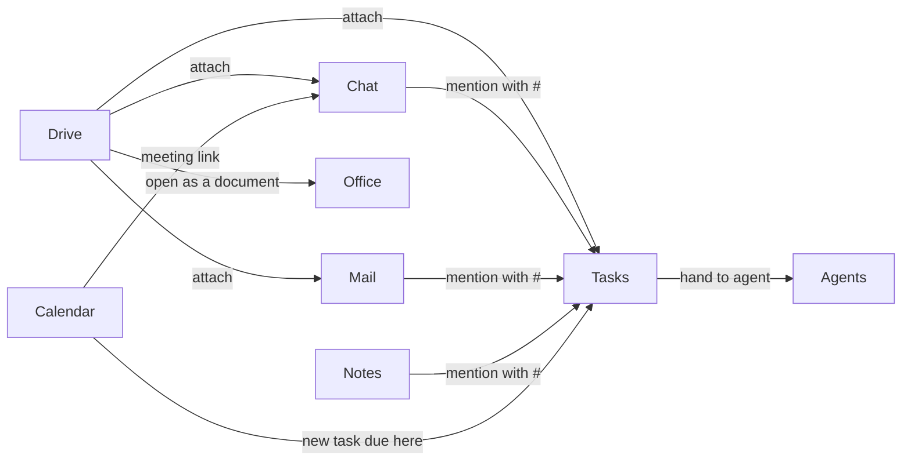

## Built in for every app you deploy

These work for any service Polaris deploys, with no SDK, agent or change to the app's code: they run at the edge or on the host.

|                                                                                                                                                                                                                                                    | Instead of                               | Polaris                                                                                                                               |
| -------------------------------------------------------------------------------------------------------------------------------------------------------------------------------------------------------------------------------------------------- | ---------------------------------------- | ------------------------------------------------------------------------------------------------------------------------------------- |
|   | Google Analytics, Plausible              | **Analytics** read from the edge's access log, with no script tag                                                                     |
|                                                                                                                                             | Cloudflare WAF and Access                | **Firewall** in front of every route: country and network rules, bot defences, injection scanning, bans, and an optional sign-in wall |
|                                                                                                                           | Beekeeper Studio and other database GUIs | **Databases**: browse and query Postgres, MySQL, MariaDB, MongoDB and Redis                                                           |
|                                                                                                                                          | Uptime Kuma and other uptime checkers    | **Watch**: every domain probed, a sustained outage alerted                                                                            |
|                                                                                                                                                      | Datadog and other metrics agents         | **Metrics** for every container and server, read over SSH and Docker                                                                  |
|                                                                                                                                     | Certbot                                  | **HTTPS**: Let's Encrypt certificates issued and renewed for each public domain                                                       |

 Error tracking is the exception: **Telemetry** takes events from the Sentry SDK your app already uses, so the one change is the DSN.

## How it works

### Updating

The Update button in Settings is how an installed Polaris is updated. The limited edition has no host daemon, so there the button reports that updates are unavailable.

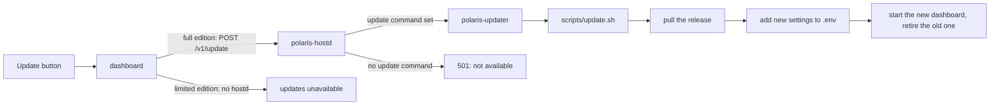

### A request through the edge

Every router has an explicit priority, highest first. Routes with firewall rules pass through the guard before reaching the app.

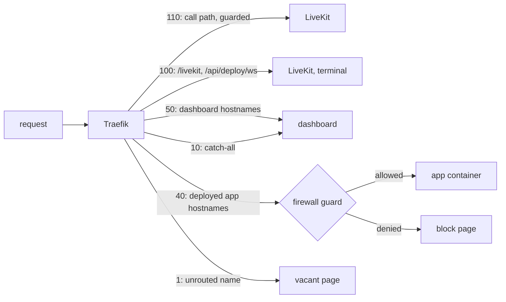

### Deploying an app

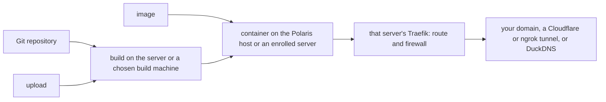

### Repository layout

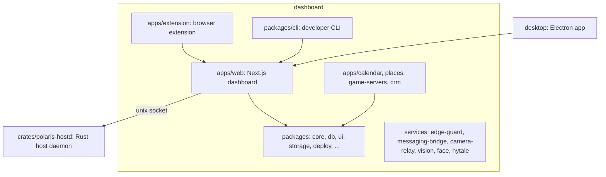

## Usage

Once it is up, open the dashboard and create your account - **the first account
becomes the administrator**.

On your local network it is also reachable at **`http://polaris.local`** (mDNS),
and at **`http://polaris`** from the machine running it.

The desktop app (Windows, macOS, Linux) opens an instance in its own window with
system notifications; see [`desktop/README.md`](desktop/README.md).

## Requirements

[Docker Engine](https://docs.docker.com/engine/install/) with the Compose v2
plugin. For local development without containers, see the
[developer guide](docs/developers/README.md).

**Run it on Linux** (Ubuntu Server is the tested target). Polaris uses
privileged mounts, the host's Docker engine and host networking, which are
native there.

Windows is not recommended as the host: Docker runs inside WSL, so Polaris
manages that virtual machine instead of the machine itself, and mounts and host
networking behave differently or not at all. A Windows machine works fine as an
additional **server** managed from a Linux install.

## Contributing

How to report a bug, propose a change and open a pull request is in
[CONTRIBUTING.md](CONTRIBUTING.md); everyone taking part follows the
[code of conduct](CODE_OF_CONDUCT.md). The monorepo layout, the development
loop, how to build and test the dashboard and the Rust components, and the
release flow all live in the [developer guide](docs/developers/README.md).

## License

Polaris is licensed under the [GNU AGPL-3.0](LICENSE) with the additional terms
in [NOTICE.md](NOTICE.md):

- Use it, change it and share it, commercially too, under the AGPL-3.0.
- A modified version - distributed, or offered to people over a network - must
  publish its full source under the same license. Closed-source forks are not
  allowed.
- A modified version must say visibly that it is based on Polaris.

To use Polaris outside those terms, for example in a closed-source product or a
hosted service whose source you do not publish, ask for a commercial license
(see [NOTICE.md](NOTICE.md)). Releases published before this change remain
under Apache-2.0.

To cite Polaris, use [CITATION.cff](CITATION.cff).
