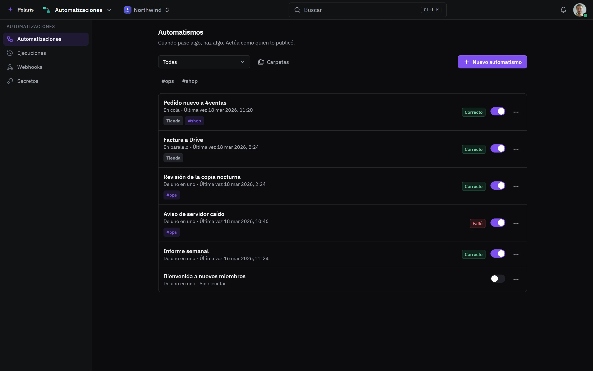

# Automatizaciones

[Read in English](automations.md) - [Volver al README](../../README.es.md)

Cuando algo ocurre, se hace otra cosa en tus apps. Cada automatización se ejecuta
como quien la publicó.

Cada imagen es la interfaz real dibujada con personas y datos inventados, y
sigue tu ajuste claro u oscuro. Las versiones para móvil están en
[docs/assets/media](../assets/media).

## Todo lo que va solo

<picture>
  <source media="(prefers-color-scheme: light)" srcset="../assets/media/automations-light-es-desktop.webp">
  
</picture>

Cada una dice cuándo se ejecutó y si fue bien, y va de uno en uno, en cola o
en paralelo. Las ejecuciones, los webhooks y los secretos tienen su propia
pantalla.

## Formulario web

Añade el disparador **Formulario web** y pega en tu web el HTML que te da; cada
envío arranca la automatización con los campos recibidos. Una página no puede
guardar un secreto, así que el formulario no lleva token: indica qué sitios
pueden enviar, y un campo oculto y un límite de 5 envíos por minuto y dirección
frenan a los bots. Los envíos que rellenan el campo oculto quedan en Spam y no
ejecutan nada. Indica una página de gracias a la que ir tras enviar, o déjala
vacía para recibir una respuesta JSON. Los envíos se exportan en CSV.
