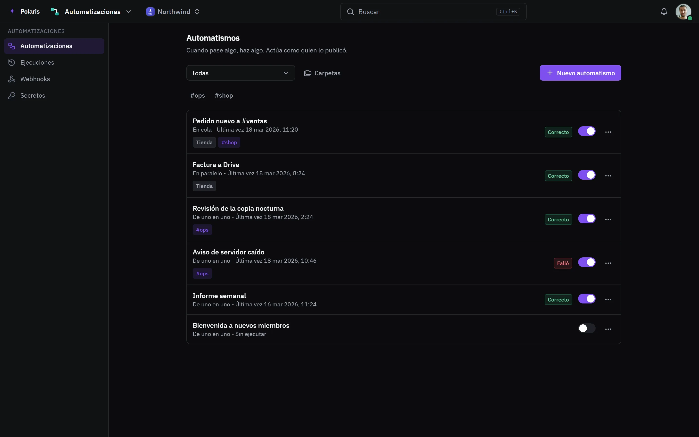

# Automatismos

[Read in English](automations.md) - [Volver al README](../../README.es.md)

Cuando algo ocurre, se hace otra cosa en tus apps. Cada automatismo se ejecuta
como quien lo publicó.

Cada imagen es la interfaz real dibujada con personas y datos inventados, y
sigue tu ajuste claro u oscuro. Las versiones para móvil están en
[docs/assets/media](../assets/media).

## Todo lo que va solo

<picture>
  <source media="(prefers-color-scheme: light)" srcset="../assets/media/automations-light-es-desktop.webp">
  
</picture>

Cada uno dice cuándo se ejecutó y si fue bien, y va de uno en uno, en cola o
en paralelo. Las ejecuciones, los webhooks y los secretos tienen su propia
pantalla.
