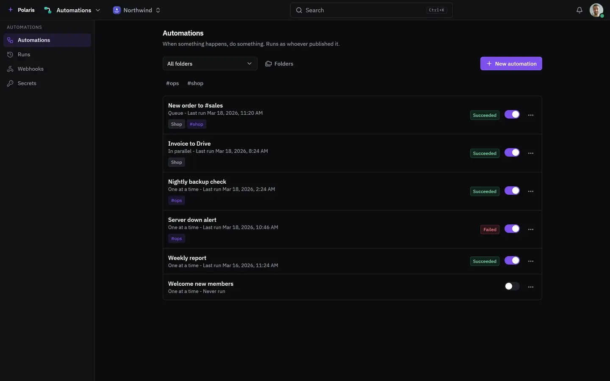

# Automations

[Leer en español](automations.es.md) - [Back to the README](../../README.md)

When something happens, do something, across your apps. Each automation runs
as whoever published it.

Every picture is the real interface drawn with made-up people and data, and
follows your light or dark setting. Phone-sized versions are in
[docs/assets/media](../assets/media).

## Everything that runs on its own

<picture>
  <source media="(prefers-color-scheme: light)" srcset="../assets/media/automations-light-en-desktop.webp">
  
</picture>

Each one says when it last ran and whether that went well, and runs one at a
time, in a queue or in parallel. Runs, webhooks and secrets each have their
own screen.

## Website form

Add the **Website form** trigger and paste the HTML it gives you into your
site; every post starts the automation with the fields it sent. A page cannot
keep a secret, so a form has no token: list the sites allowed to post, and a
hidden field plus a limit of 5 posts a minute per address keep bots out. Posts
that fill the hidden field are kept under Spam and run nothing. Set a thank-you
address to send people on after they submit, or leave it empty to get a JSON
answer. Submissions export as CSV.
