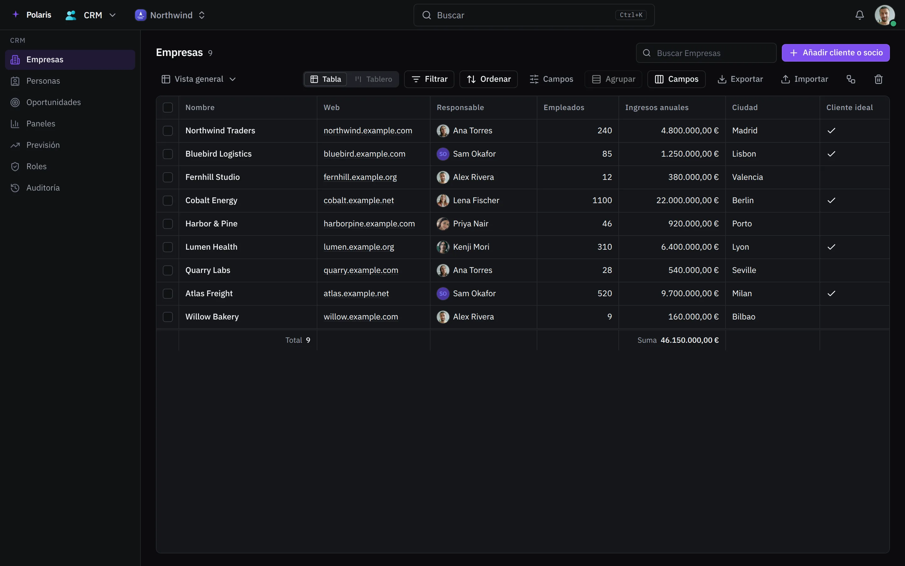

# CRM

[Read in English](crm.md) - [Volver al README](../../README.es.md)

Empresas, personas y las oportunidades en las que trabajas, para una
organización. La propia organización es el espacio de trabajo, no un registro:
sus miembros no aparecen aquí como personas.

Cada imagen es la interfaz real dibujada con personas y datos inventados, y
sigue tu ajuste de modo claro u oscuro. Las versiones para móvil están en
[docs/assets/media](../assets/media).

## Listas y vistas

<picture>
  <source media="(prefers-color-scheme: light)" srcset="../assets/media/crm-light-es-desktop.webp">
  
</picture>

Hay tres listas: **Empresas**, **Personas** y **Oportunidades**. Cada una se
abre como tabla o como tablero, y cualquier disposición se puede guardar como
**vista**, compartida por toda la organización. Las oportunidades pasan por las
etapas Nueva, Filtrado, Reunión, Propuesta, Cliente y Perdida; arrastra una tarjeta en el tablero
para moverla.

**Filtrar** con reglas y grupos de reglas, **Ordenar** y **Agrupar** por
cualquier campo, buscar, ocultar y redimensionar columnas, y añadir totales bajo
una columna. Selecciona filas para cambiar un campo en todas a la vez o
llevarlas a la papelera. **Exportar** descarga las filas de la vista actual como
archivo CSV.

## Un registro

Un registro se abre como panel o en su propia página, con sus campos, los
registros vinculados y una cronología de cada cambio. Junto a ellos están sus
notas, tareas, archivos de Drive, correo y eventos del calendario. Los registros
se pueden compartir, enlazar por su dirección y añadir a favoritos.

**Campos** añade columnas propias: texto, número, importe, fecha, sí / no,
opción, varias opciones, valoración, enlace, enlaces, dirección, correo,
teléfono y registros vinculados. Un campo que añades aparece como columna, como
filtro y como grupo del tablero.

## Importar y duplicados

**Importar** añade registros desde un archivo CSV. Asigna cada columna a un
campo, u omítela; las filas con problemas se listan antes de escribir nada, y
empresas, personas y responsables se emparejan por nombre. La opción de omitir
duplicados deja fuera las filas con el mismo correo, dominio o nombre que un
registro existente, o que una fila anterior del archivo.

Cuando un registro nuevo se parece a uno que ya existe, el CRM lo avisa.
**Fusionar** conserva un registro, rellena sus campos vacíos con los de los
demás y lleva los demás a la papelera. La **Papelera** restaura registros o los
borra definitivamente.

## Flujos

Los **Flujos** hacen cosas solos cuando cambian los registros. Un flujo empieza
cuando se crea, cambia o borra un registro, cuando cambia un campo, a mano sobre
un registro, con un horario, o con una llamada externa a la dirección secreta
que recibe al guardarse. Sus pasos pueden actualizar o crear un registro, crear
una tarea, enviar una notificación, un correo o un mensaje de chat, enviar a una
dirección, esperar, esperar hasta que el registro coincida, seguir solo si
coincide, bifurcarse o repetirse para cada registro encontrado. Cada uno muestra
cuántas veces se ejecutó y su última ejecución. Un flujo se ejecuta como la
persona que lo guardó por última vez.

## Paneles y previsión

Los **Paneles** ponen recuentos y totales de tus registros uno junto a otro:
añade un gráfico para contar registros, sumar importes, dividirlos por un campo
o seguirlos en el tiempo. Un gráfico puede ponderar cada oportunidad por la
probabilidad de su etapa.

**Previsión** muestra las oportunidades abiertas y las ganadas por mes o
trimestre, de todos o solo las tuyas, en cuanto tienen fecha de cierre. Aquí se
fija la probabilidad de cada etapa y todas las previsiones la usan; solo quien
puede cambiar oportunidades puede cambiarla.

## Roles e historial

**Roles** define qué ve y cambia cada rol de la organización en el CRM, además
de lo que permiten sus permisos: todos los registros o solo los suyos, y para
cada campo si el rol puede cambiarlo, solo leerlo o no verlo. Solo quien
gestiona los roles de la organización puede cambiarlo.

**Auditoría** lista cada cambio (quién, cuándo, qué registro y campo, antes y
después), filtrado por objeto, tipo, persona y fechas, y se exporta como
archivo.
