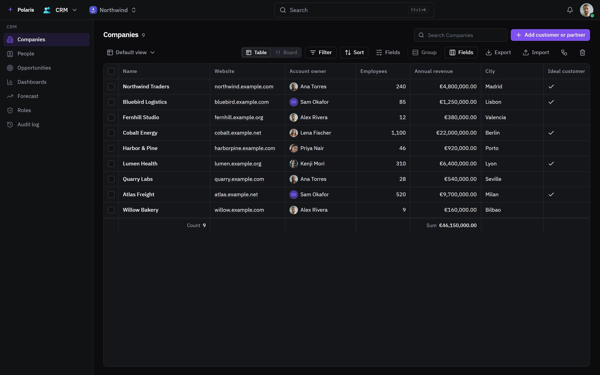

# CRM

[Leer en español](crm.es.md) - [Back to the README](../../README.md)

Companies, people and the deals you are working, for an organization. The
organization itself is the workspace, not a record: its own members are not
listed as people here.

Every picture is the real interface drawn with made-up people and data, and
follows your light or dark setting. Phone-sized versions are in
[docs/assets/media](../assets/media).

## Lists and views

<picture>
  <source media="(prefers-color-scheme: light)" srcset="../assets/media/crm-light-en-desktop.webp">
  
</picture>

There are three lists: **Companies**, **People** and **Opportunities**. Each
opens as a table or a board, and any arrangement can be saved as a **view** that
everyone in the organization shares. Opportunities move through the stages New,
Screening, Meeting, Proposal, Customer and Lost; drag a card on the board to
move it.

**Filter** with rules and groups of rules, **Sort** and **Group** by any field,
search, hide and resize columns, and add totals under a column. Select rows to
edit one field on all of them at once or move them to the trash. **Export**
downloads the rows of the current view as a CSV file.

## A record

A record opens as a panel or its own page, with its fields, the records linked
to it and a timeline of every change. Beside them are its notes, tasks, files
from Drive, mail and calendar events. Records can be shared, linked to by
address, and added to your favorites.

**Fields** adds your own columns: text, number, amount, date, yes / no, choice,
several choices, rating, link, links, address, email, phone and linked records.
A field you add shows up as a column, a filter and a board group.

## Importing and duplicates

**Import** adds records from a CSV file. Match each column to a field, or skip
it; rows with a problem are listed before anything is written, and companies,
people and owners are matched by name. **Skip duplicates** leaves out rows with
the same email, domain or name as a record already here, or as an earlier row of
the file.

When a new record looks like one that exists, the CRM says so. **Merge** keeps
one record, fills its empty fields from the others, and moves the others to the
trash. The **Trash** restores records or deletes them for good.

## Workflows

**Workflows** do things on their own when records change. A workflow starts
when a record is created, changed or deleted, when a field changes, by hand on a
record, on a schedule, or on an outside call to the secret address it is given
when saved. Its steps can update or create a record, create a task, send a
notification, an email or a chat message, send to an address, wait, wait until
the record matches, go on only if it matches, branch, or repeat for each record
found. Each one shows how many times it ran and its last run. A workflow runs as
the person who last saved it.

## Dashboards and forecast

**Dashboards** put counts and totals of your records side by side: add a chart
to count records, add up amounts, split them by a field or follow them over
time. A chart can weigh each deal by its stage's odds.

**Forecast** shows open deals and deals won by month or quarter, for everyone
or only yours, once they have a close date. The odds of each stage are set here
and every forecast uses them; only people who can change opportunities can
change the odds.

## Roles and history

**Roles** sets what each role of the organization sees and changes in the CRM,
on top of what its permissions allow: every record or only its own, and for each
field whether the role can change it, only read it, or not see it. Only people
who manage the organization's roles can change these.

**Audit log** lists every change - who, when, which record and field, before and
after - filtered by object, kind, person and dates, and exports as a file.
