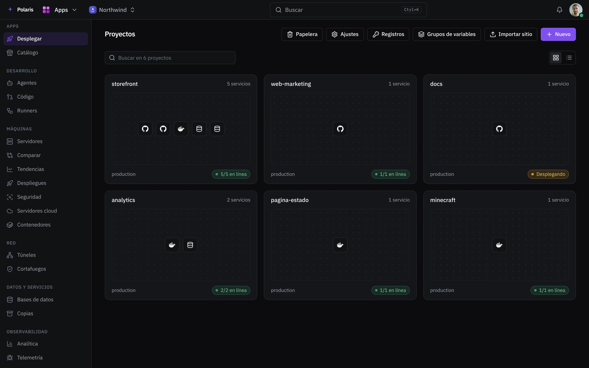
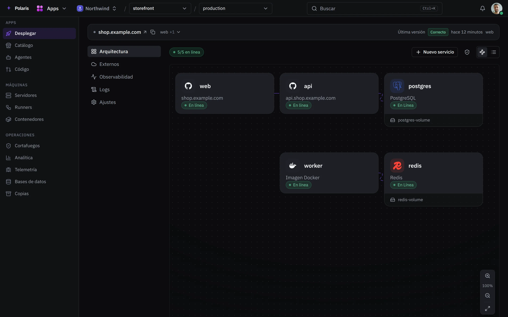
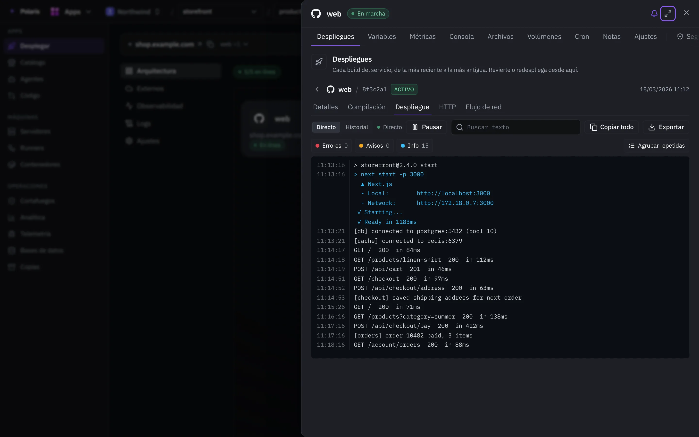

# Deploy

[Read in English](deploy.md) - [Volver al README](../../README.es.md)

Ejecuta apps en tus propias máquinas desde un repositorio Git, una imagen o una
subida, con sus bases de datos, volúmenes y dominios. Los proyectos de Vercel,
Railway y AWS aparecen al lado.

Cada imagen es la interfaz real dibujada con personas y datos inventados, y
sigue tu ajuste claro u oscuro. Las versiones para móvil están en
[docs/assets/media](../assets/media).

## Tus proyectos

<picture>
  <source media="(prefers-color-scheme: light)" srcset="../assets/media/deploy-light-es-desktop.webp">
  
</picture>

Cada proyecto muestra sus servicios y si están en marcha. Los proyectos son
tuyos o de una organización, que es lo que cambia el selector de la cabecera.

## El lienzo de un proyecto

<picture>
  <source media="(prefers-color-scheme: light)" srcset="../assets/media/deploy-project-light-es-desktop.webp">
  
</picture>

Un proyecto es un lienzo de servicios, bases de datos y volúmenes, con las
líneas que los unen. Puede tener varios entornos, cada uno vacío o copiado de
otro. Los cambios esperan en un aviso hasta que alguien los despliega, así que
un servicio eliminado no se elimina hasta entonces.

## Versiones y logs

<picture>
  <source media="(prefers-color-scheme: light)" srcset="../assets/media/deploy-logs-light-es-desktop.webp">
  
</picture>

Cada servicio tiene sus despliegues, variables, métricas, una consola, sus
archivos, volúmenes, tareas programadas, notas, ajustes, seguridad y analítica.
Una versión emite su log en directo. Si falla, Polaris lee el log, dice qué es
lo más probable que fallara y ofrece el arreglo en un clic.

## Llegar a él

Acceso público con tu propio dominio y un certificado de Let's Encrypt, un
túnel de Cloudflare o un nombre de DuckDNS; los servicios también se hablan por
una red privada propia. Cada ruta puede ir detrás del firewall y de un muro de
inicio de sesión opcional, y cada dominio se vigila. Las bases de datos -
Postgres, MySQL, MariaDB, MongoDB y Redis - se exploran, consultan y respaldan
desde el mismo sitio.

## Variables, referencias y la red privada

Cada servicio tiene sus propias variables, y un entorno tiene **variables
compartidas** que cualquier servicio suyo puede usar. Un valor puede apuntar a
otro en lugar de repetirlo:

- `${{shared.CLAVE}}` - una variable compartida del entorno.
- `${{servicio.CLAVE}}` - una variable de otro servicio del mismo entorno,
  por el nombre del servicio. Una base de datos responde igual, con
  `DATABASE_URL` y el resto de sus datos de conexión.
- `${{servicio.POLARIS_PRIVATE_DOMAIN}}` - el nombre al que responde el
  servicio en la red privada.

Las referencias se resuelven cuando el servicio se despliega, así que siempre
arranca con el valor actual. Una referencia solo alcanza servicios del mismo
entorno: un servicio de staging no puede leer uno de producción. Si una
referencia no se puede resolver, el despliegue se detiene y nombra la variable.

Cada servicio responde a `<nombre>.polaris.internal`, y a su nombre a secas, en
una red privada. Los entornos creados desde Deploy se quedan esa red para
ellos: a un servicio sin dominio público solo llegan los demás servicios de su
entorno. Su nombre privado se edita en **Ajustes > Red**.

### Ejemplo: un servicio que solo usan los demás

Un proyecto tiene dos servicios: `egress-proxy`, un proxy HTTP con contraseña,
y `worker`, que envía sus peticiones de salida a través de él.

1. En `egress-proxy`, añade una variable `PROXY_PASSWORD` con un valor
   aleatorio largo, y no le des dominio público. Nada fuera del entorno llega
   a él.
2. En `worker`, añade:

   ```
   HTTPS_PROXY=http://worker:${{egress-proxy.PROXY_PASSWORD}}@${{egress-proxy.POLARIS_PRIVATE_DOMAIN}}:3128
   ```

3. Despliega `worker`. Arranca con la contraseña ya puesta y llega al proxy
   por su nombre privado. La contraseña se escribe una vez, en un solo sitio.

Para cambiar la contraseña, cámbiala en `egress-proxy` y vuelve a desplegar los
dos servicios: `worker` recoge el valor nuevo al desplegarse.
