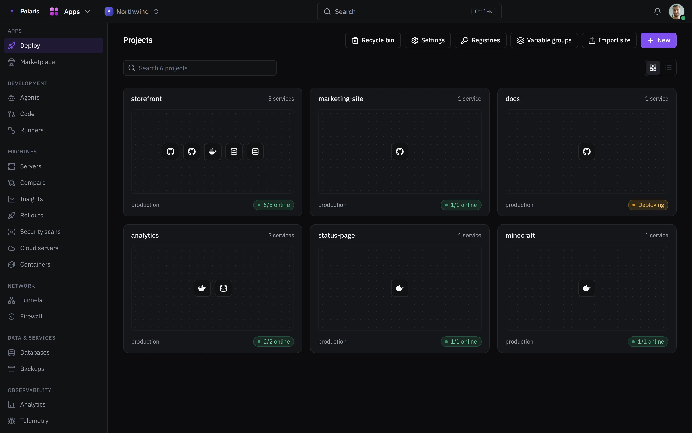
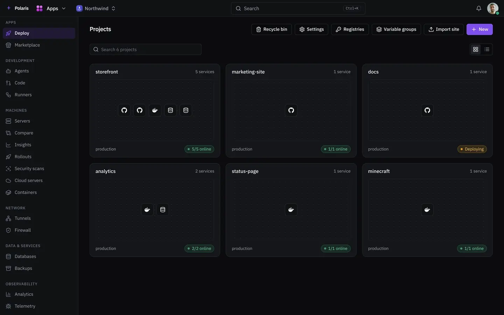
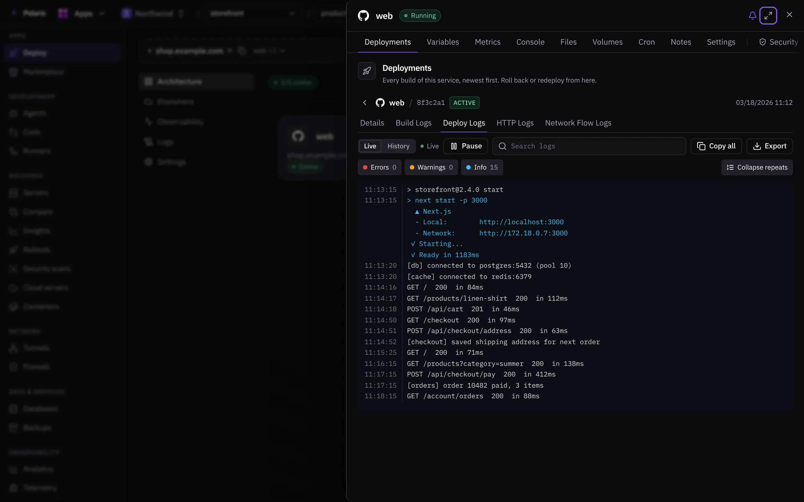

# Deploy

[Leer en español](deploy.es.md) - [Back to the README](../../README.md)

Run apps on your own machines from a Git repository, an image or an upload,
with their databases, volumes and domains. Projects on Vercel, Railway and AWS
sit beside them.

Every picture is the real interface drawn with made-up people and data, and
follows your light or dark setting. Phone-sized versions are in
[docs/assets/media](../assets/media).

## Your projects

<picture>
  <source media="(prefers-color-scheme: light)" srcset="../assets/media/deploy-light-en-desktop.webp">
  
</picture>

Every project shows its services and whether they are up. Projects belong to
you or to an organization, which is what the switch in the header changes.

## A project's canvas

<picture>
  <source media="(prefers-color-scheme: light)" srcset="../assets/media/deploy-project-light-en-desktop.webp">
  
</picture>

A project is a canvas of services, databases and volumes, with the lines
between them. A project can have several environments, each started empty or
as a copy of another. Changes wait in a banner until somebody deploys them, so
a removed service is not removed until then.

## Releases and logs

<picture>
  <source media="(prefers-color-scheme: light)" srcset="../assets/media/deploy-logs-light-en-desktop.webp">
  
</picture>

Each service has its deployments, variables, metrics, a console, its files,
volumes, scheduled jobs, notes, settings, security and analytics. A release
streams its log live. When one fails, Polaris reads the log, says what most
likely went wrong, and offers the fix as one press.

## Reaching it

Public access through your own domain with a Let's Encrypt certificate, a
Cloudflare tunnel or a DuckDNS name; services can also talk over a private
network of their own. Every route can sit behind the firewall and an optional
sign-in wall, and every domain is probed for uptime. Databases - Postgres,
MySQL, MariaDB, MongoDB and Redis - are browsed, queried and backed up from
the same place.

## Variables, references and the private network

Each service has its own variables, and an environment has **shared
variables** every service in it can use. A value can point at another one
instead of repeating it:

- `${{shared.KEY}}` - a shared variable of the environment.
- `${{service.KEY}}` - a variable of another service in the same environment,
  named by its service name. A database answers to the same form, with
  `DATABASE_URL` and the rest of its connection details.
- `${{service.POLARIS_PRIVATE_DOMAIN}}` - the name the service answers to on
  the private network.

References are resolved when a service deploys, so it always starts with the
current value. A reference only reaches services of the same environment: a
staging service cannot read a production one. A reference that cannot be
resolved stops the deploy and names the variable.

Every service answers to `<name>.polaris.internal`, and to its bare name, on a
private network. Environments made from the Deploy screen keep that network to
themselves: a service with no public domain can only be reached by the other
services of its environment. Its private name is edited in **Settings >
Networking**.

### Example: a service only the others can use

A project has two services: `egress-proxy`, an authenticated HTTP proxy, and
`worker`, which sends its outbound requests through it.

1. In `egress-proxy`, add a variable `PROXY_PASSWORD` with a long random value,
   and give it no public domain. Nothing outside the environment can reach it.
2. In `worker`, add:

   ```
   HTTPS_PROXY=http://worker:${{egress-proxy.PROXY_PASSWORD}}@${{egress-proxy.POLARIS_PRIVATE_DOMAIN}}:3128
   ```

3. Deploy `worker`. It starts with the password filled in, and reaches the
   proxy by its private name. The password is typed once, in one place.

To change the password, change it in `egress-proxy` and redeploy both
services: `worker` picks up the new value when it deploys.
