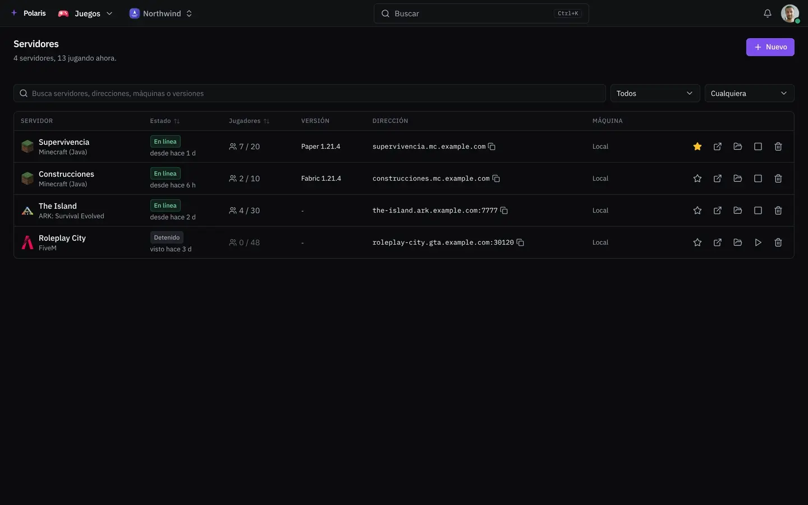
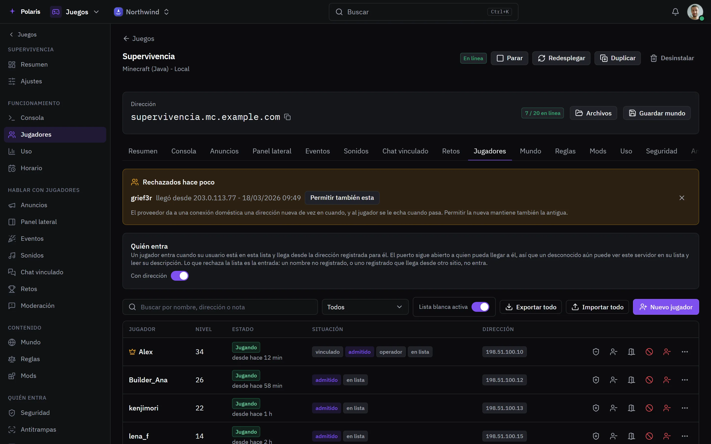
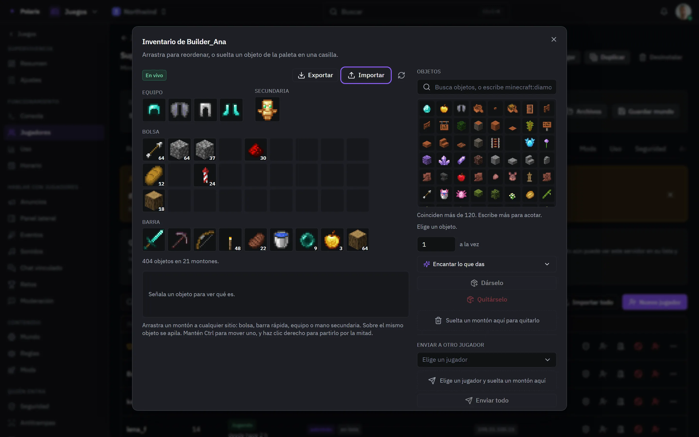
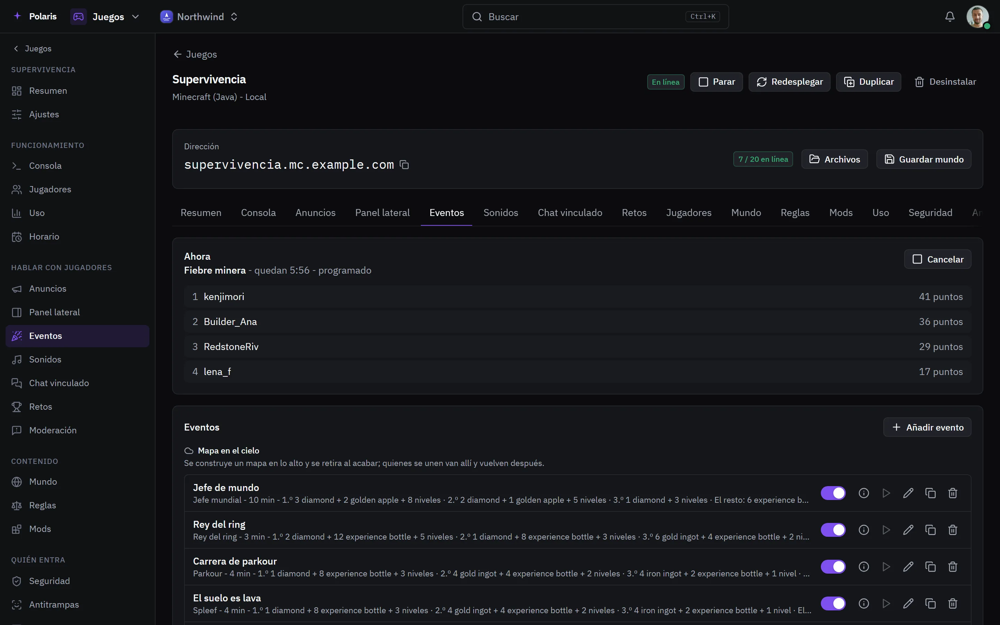
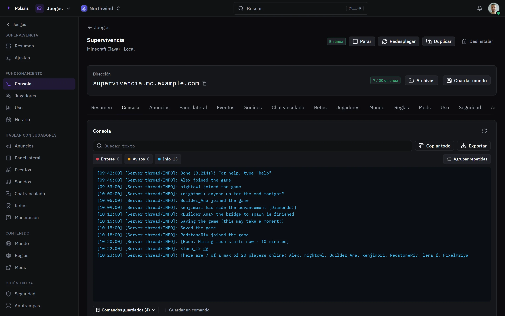

# Servidores de juegos

[Read in English](game-servers.md) - [Volver al README](../../README.es.md)

Servidores de Minecraft (Java y Bedrock), ARK y FiveM en tus propias máquinas,
creados y gestionados desde Polaris, cada uno con una dirección en tu dominio.

Cada imagen es la interfaz real dibujada con personas y datos inventados, y
sigue tu ajuste claro u oscuro. Las versiones para móvil están en
[docs/assets/media](../assets/media).

## Todos los servidores

<picture>
  <source media="(prefers-color-scheme: light)" srcset="../assets/media/games-light-es-desktop.webp">
  
</picture>

Cada servidor muestra si está encendido, quién juega y la dirección que
escriben los jugadores. Desde aquí se inicia, se detiene, se duplica o se
archiva. La imagen sigue dentro de uno de ellos: sus jugadores, el inventario
y la skin de un jugador, los eventos en curso, y los ajustes de Minecraft,
ARK y FiveM.

## Jugadores

<picture>
  <source media="(prefers-color-scheme: light)" srcset="../assets/media/game-players-light-es-desktop.webp">
  
</picture>

Quién juega y desde cuándo, su nivel, y si es operador, está en la lista
blanca o está baneado. Cada fila expulsa, banea, silencia un tiempo,
teletransporta, cambia el modo de juego o da experiencia. Quién puede entrar es
una lista de nombres, cada uno ligado a las direcciones desde las que juega, y
un jugador se puede vincular a una cuenta de Polaris para que sus inicios de
sesión mantengan esa lista al día.

## Inventarios

<picture>
  <source media="(prefers-color-scheme: light)" srcset="../assets/media/game-inventory-light-es-desktop.webp">
  
</picture>

El inventario de un jugador tal como lo dibuja el juego. Las pilas se
arrastran entre casillas, los objetos se dan desde la paleta con o sin
encantamientos, se quitan o se envían a otro jugador. Los inventarios se
exportan e importan como archivo. Si alguien no está conectado, lo que le dejes
espera y se le entrega al entrar.

## Eventos

<picture>
  <source media="(prefers-color-scheme: light)" srcset="../assets/media/game-events-light-es-desktop.webp">
  
</picture>

Competiciones en el servidor - fiebre minera, parkour, spleef, un jefe de
mundo, búsquedas del tesoro y muchas más - lanzadas a mano, programadas o
sorteadas. La que está en marcha muestra su marcador, y los premios llegan a
los ganadores, también a quien no estaba conectado.

## Consola

<picture>
  <source media="(prefers-color-scheme: light)" srcset="../assets/media/game-console-light-es-desktop.webp">
  
</picture>

El registro del servidor, con búsqueda y filtros de errores y avisos, y una
línea para enviar comandos. Los comandos que usas a menudo se guardan como
botones y se pueden programar para que se ejecuten solos.

## Y el resto

Cada servidor tiene además anuncios y un panel lateral en la pantalla de los
jugadores, sus propios sonidos, un canal de chat vinculado, retos y pase de
temporada, el mundo, reglas, mods y modpacks, consumo, seguridad, anti-trampas,
moderación del chat, un horario para reinicios, copias y dormir cuando está
vacío, y ajustes. El acceso se comparte por servidor, así que
alguien puede moderar jugadores sin ver la consola ni los ajustes.
