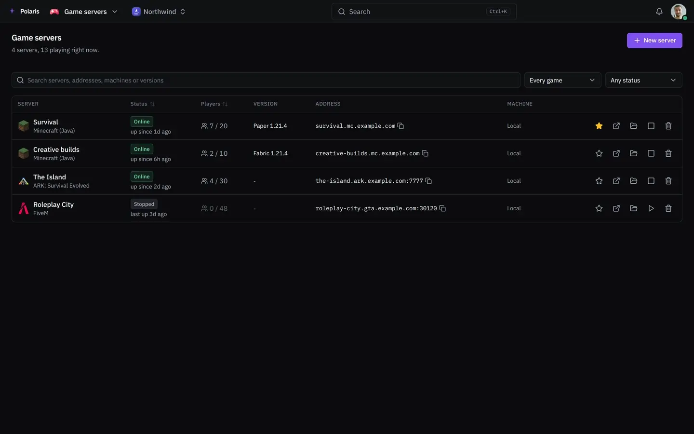
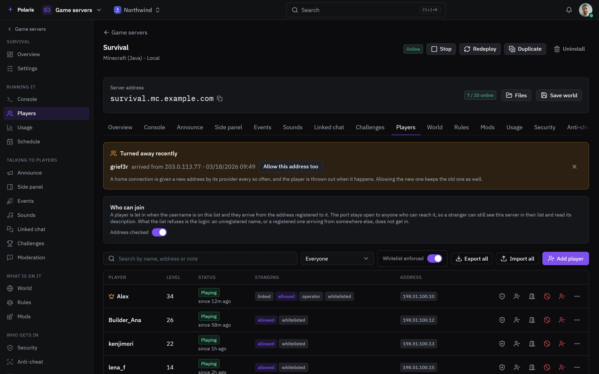
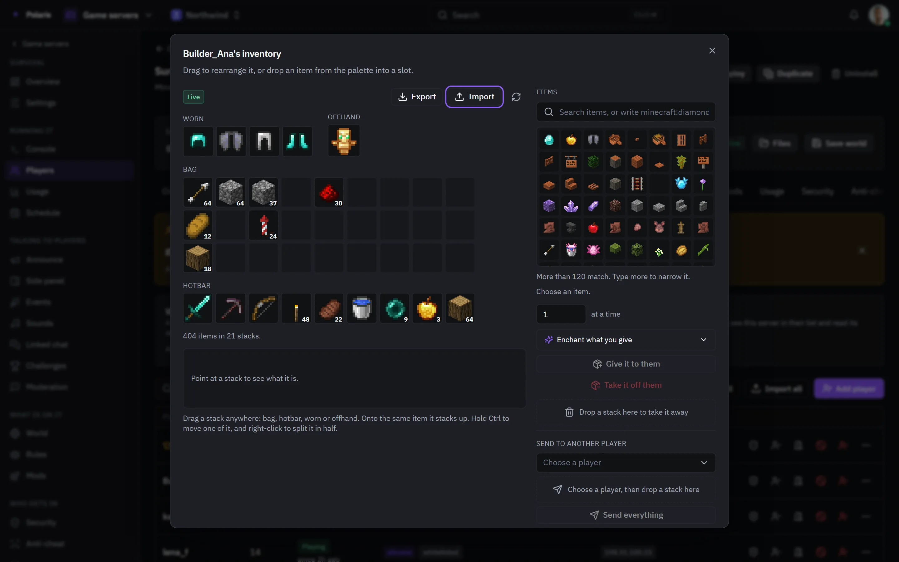
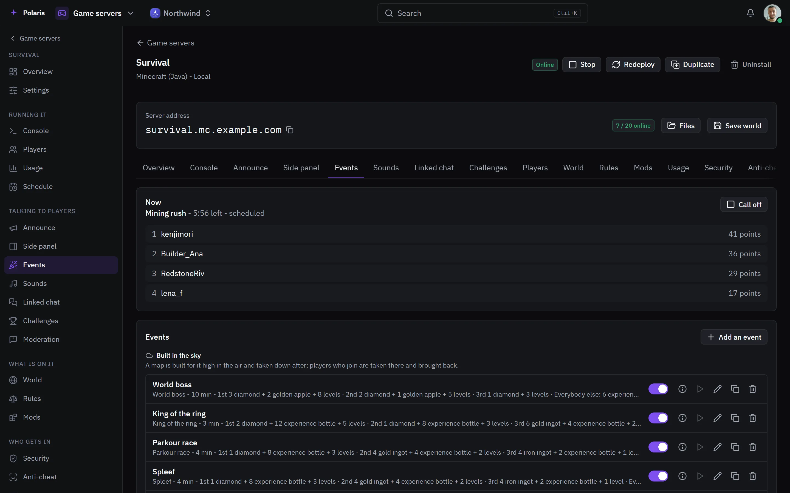
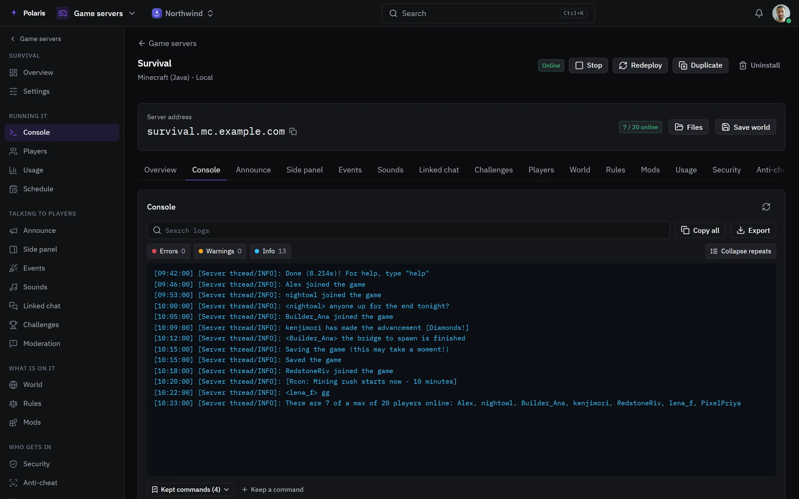

# Game servers

[Leer en español](game-servers.es.md) - [Back to the README](../../README.md)

Minecraft (Java and Bedrock), ARK and FiveM servers on your own machines,
created and run from Polaris, each with an address under your domain.

Every picture is the real interface drawn with made-up people and data, and
follows your light or dark setting. Phone-sized versions are in
[docs/assets/media](../assets/media).

## Every server

<picture>
  <source media="(prefers-color-scheme: light)" srcset="../assets/media/games-light-en-desktop.webp">
  
</picture>

Every server shows whether it is up, who is playing and the address players
type. A server can be started, stopped, duplicated or archived from here. The
picture goes on into one of them: its players, a player's inventory and skin,
the events running, and the settings for Minecraft, ARK and FiveM.

## Players

<picture>
  <source media="(prefers-color-scheme: light)" srcset="../assets/media/game-players-light-en-desktop.webp">
  
</picture>

Who is playing and since when, their level, and whether they are an operator,
on the whitelist or banned. Each row kicks, bans, times out, teleports, changes
the game mode or gives experience. Who may join is a list of names, each tied
to the addresses it plays from, and a player can be linked to a Polaris
account so their sign-ins keep that list current.

## Inventories

<picture>
  <source media="(prefers-color-scheme: light)" srcset="../assets/media/game-inventory-light-en-desktop.webp">
  
</picture>

A player's inventory as the game lays it out. Stacks are dragged between
slots, items are given from the palette with or without enchantments, taken
away, or sent to another player. Inventories export and import as a file. For
somebody offline, what you drop in waits and is handed over when they join.

## Events

<picture>
  <source media="(prefers-color-scheme: light)" srcset="../assets/media/game-events-light-en-desktop.webp">
  
</picture>

Competitions run on the server - mining rush, parkour, spleef, a world boss,
treasure hunts and many more - started by hand, on a schedule or drawn at
random. The one running shows its scoreboard, and prizes go to the winners,
waiting for anybody who was offline.

## Console

<picture>
  <source media="(prefers-color-scheme: light)" srcset="../assets/media/game-console-light-en-desktop.webp">
  
</picture>

The server's log, searchable and filtered by errors and warnings, with a line
to send commands. Commands you use often are kept as buttons, and can be
scheduled to run on their own.

## And the rest

Each server also has announcements and a side panel for players' screens,
its own sounds, a linked chat channel, challenges and a season pass, the world,
rules, mods and modpacks, usage, security, anti-cheat, chat moderation, a
schedule for restarts, backups and sleeping while empty, and settings.
Access is shared per server, so somebody can moderate players without seeing
the console or the settings.
