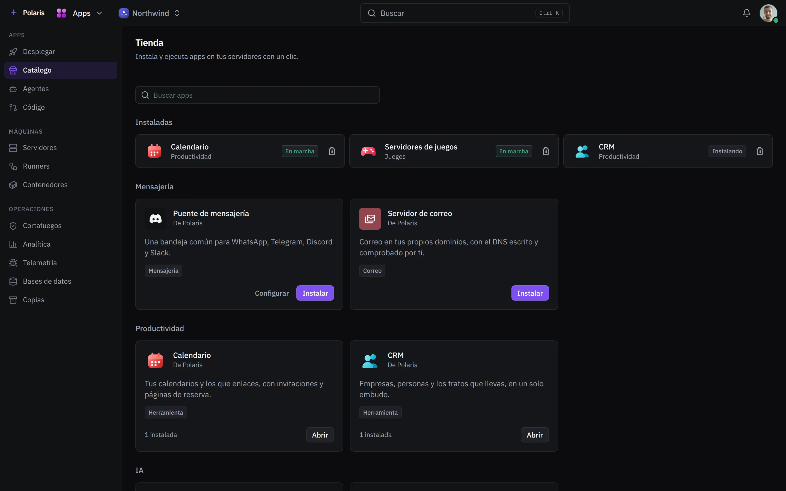
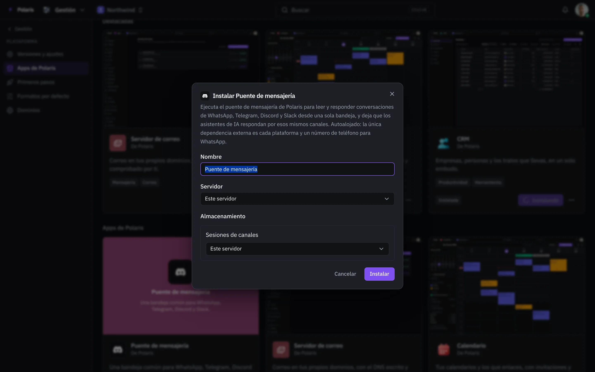
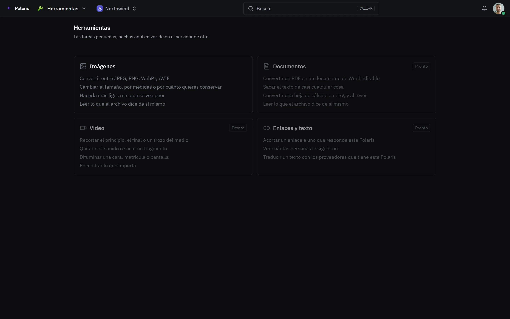
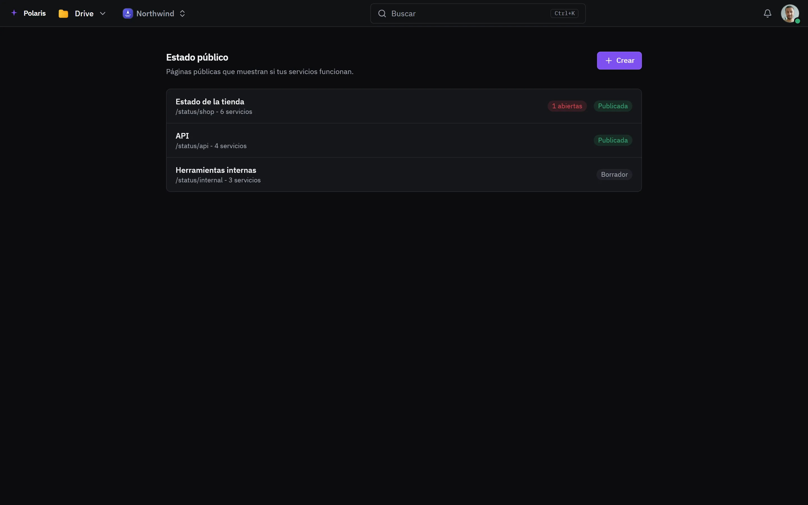
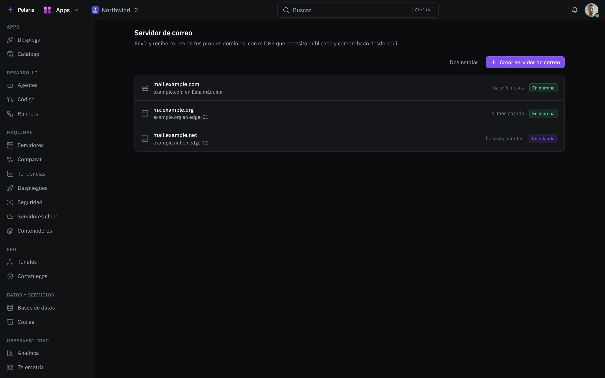
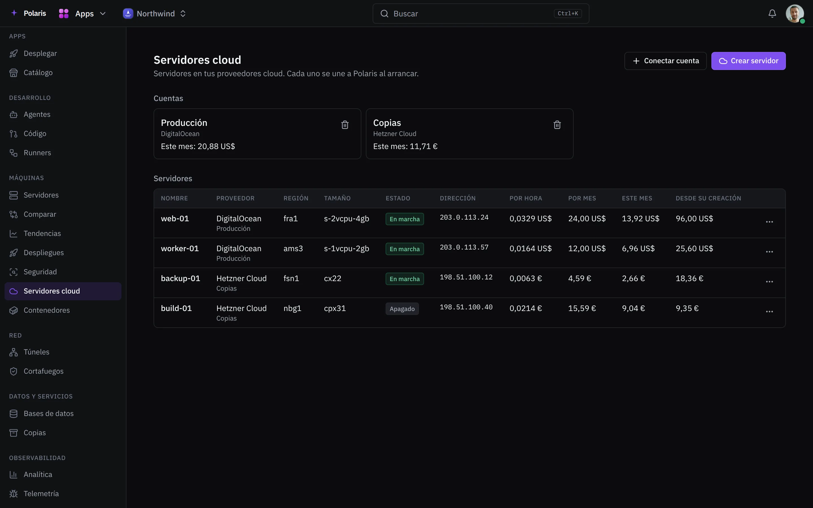
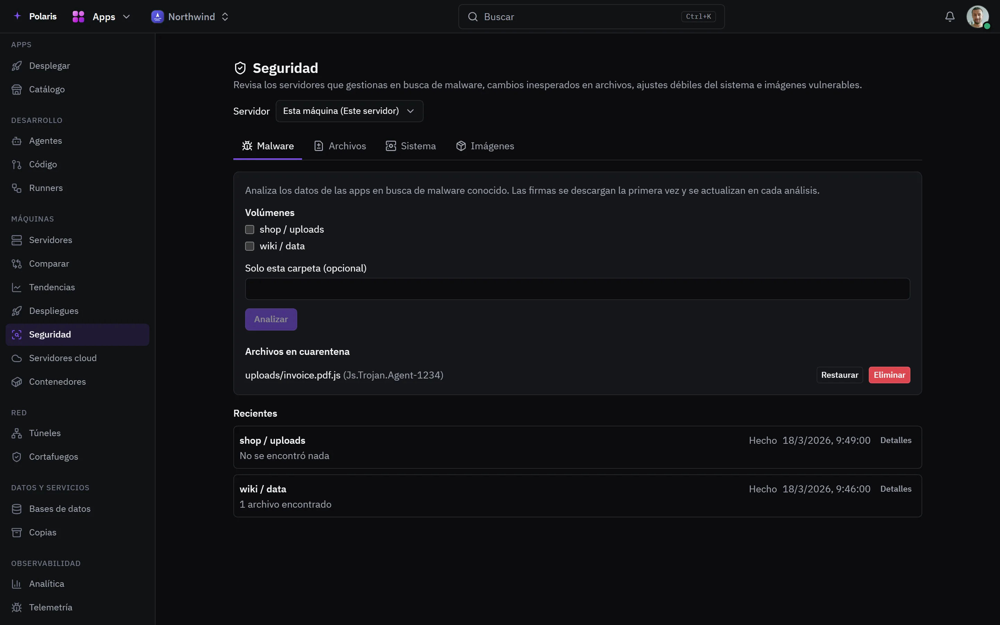
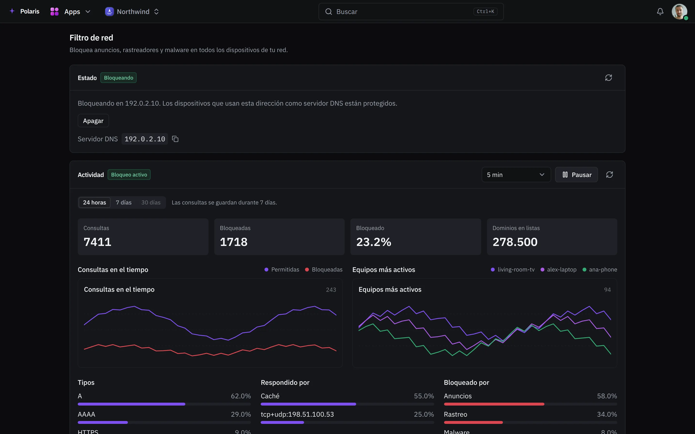

# Marketplace

[Read in English](marketplace.md) - [Volver al README](../../README.es.md)

Las apps que Polaris puede añadir, instaladas con un clic: Calendario, CRM,
Herramientas, un servidor de correo para tus dominios, servidores de juegos,
Places para cámaras y dispositivos, y el puente de mensajería detrás del Inbox.

Hay dos catálogos. Las apps propias de Polaris las activa para todos un
administrador, desde **Gestión > Apps de Polaris**, que también lista las
apps con las que viene todo Polaris - Drive, Chat, Correo, Tareas y el resto -
marcadas como Incluidas, sin nada que desinstalar. **Apps > Catálogo** es para
el software de otros desarrolladores que Polaris despliega y ejecuta por ti.

Cada imagen es la interfaz real dibujada con personas y datos inventados, y
sigue tu ajuste claro u oscuro. Las versiones para móvil están en
[docs/assets/media](../assets/media).

## El catálogo

<picture>
  <source media="(prefers-color-scheme: light)" srcset="../assets/media/marketplace-light-es-desktop.webp">
  
</picture>

Las apps instaladas van arriba con su estado, y el resto del catálogo por
categoría debajo. La mayoría no ejecuta nada al instalarse: activa sus
pantallas y descarga un motor solo cuando alguien lo usa por primera vez - el
servidor de un juego llega la primera vez que se crea un servidor de ese juego.

## Instalar eligiendo

<picture>
  <source media="(prefers-color-scheme: light)" srcset="../assets/media/marketplace-install-light-es-desktop.webp">
  
</picture>

Una app que ejecuta su propio contenedor se instala tal cual o se configura
antes: su nombre, la máquina donde corre y si cada uno de sus volúmenes vive en
esa máquina o en un NAS de Drive.

## La página de cada app

Cada app del catálogo tiene su propia página, como la ficha de una tienda: su
nombre, su marca y su descripción, qué hace, sus propias capturas para tu tema
y tu idioma, y los datos que conoce su manifiesto - desarrollador, categoría,
versión, imagen. Instalar, Configurar, Abrir y Desinstalar están en la página
y solo se ofrecen cuando tienes permiso para usarlos.

Desinstalar borra los datos de la app por defecto - sus volúmenes, ajustes y
todo lo hecho en ella, incluidos archivos como las grabaciones de cámaras - y
no deja nada atrás. Si desmarcas esa opción en el diálogo, los datos se
conservan para una reinstalación; se quedan en el servidor y aparecen en
Almacenamiento, donde puedes liberarlos más tarde.

## Algunas de las apps que añade

Cada una como se ve una vez instalada: Herramientas, Páginas de estado,
Servidor de correo, Servidores en la nube, Análisis de seguridad, CRM y Filtro
de red.

<picture>
  <source media="(prefers-color-scheme: light)" srcset="../assets/media/tools-light-es-desktop.webp">
  
</picture>

<picture>
  <source media="(prefers-color-scheme: light)" srcset="../assets/media/status-pages-light-es-desktop.webp">
  
</picture>

<picture>
  <source media="(prefers-color-scheme: light)" srcset="../assets/media/mail-server-light-es-desktop.webp">
  
</picture>

<picture>
  <source media="(prefers-color-scheme: light)" srcset="../assets/media/cloud-servers-light-es-desktop.webp">
  
</picture>

<picture>
  <source media="(prefers-color-scheme: light)" srcset="../assets/media/security-scans-light-es-desktop.webp">
  
</picture>

<picture>
  <source media="(prefers-color-scheme: light)" srcset="../assets/media/crm-light-es-desktop.webp">
  
</picture>

<picture>
  <source media="(prefers-color-scheme: light)" srcset="../assets/media/network-filter-light-es-desktop.webp">
  
</picture>
