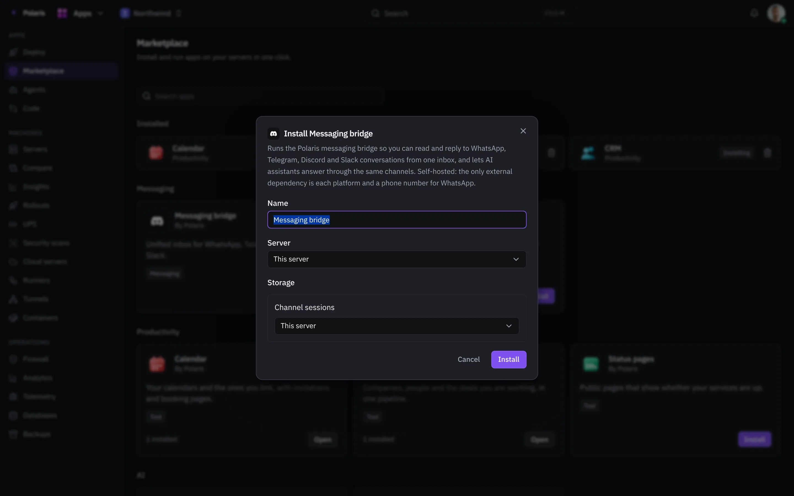
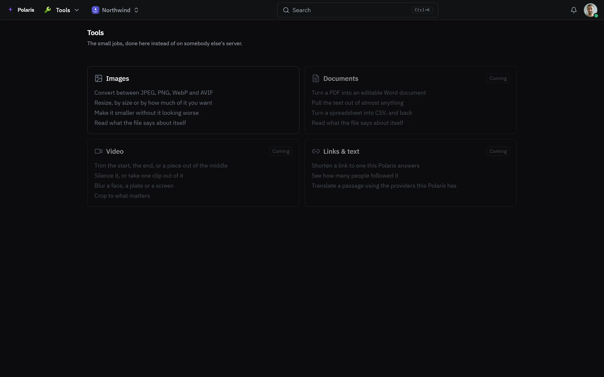
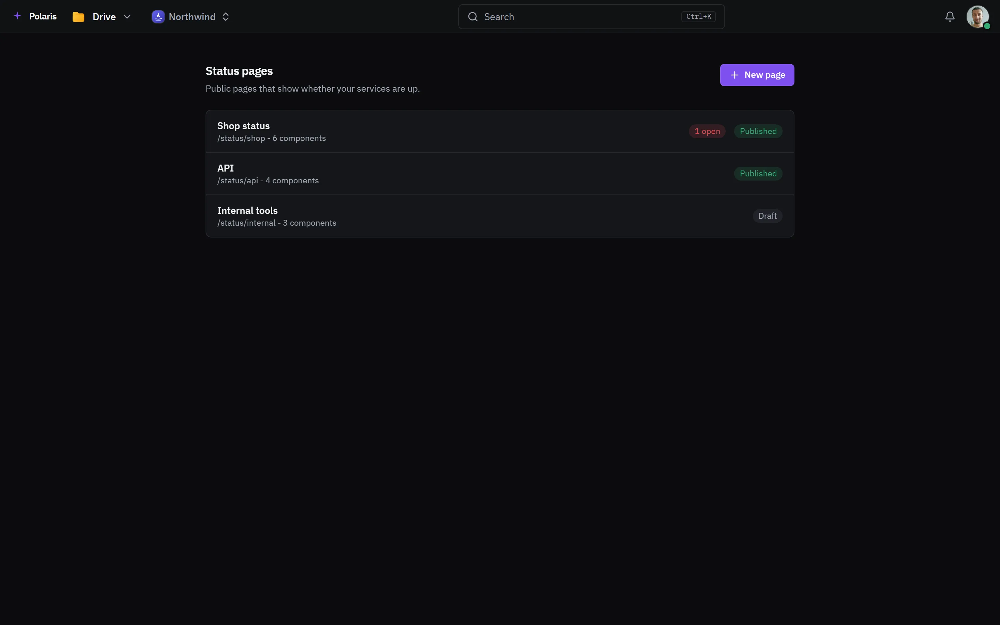
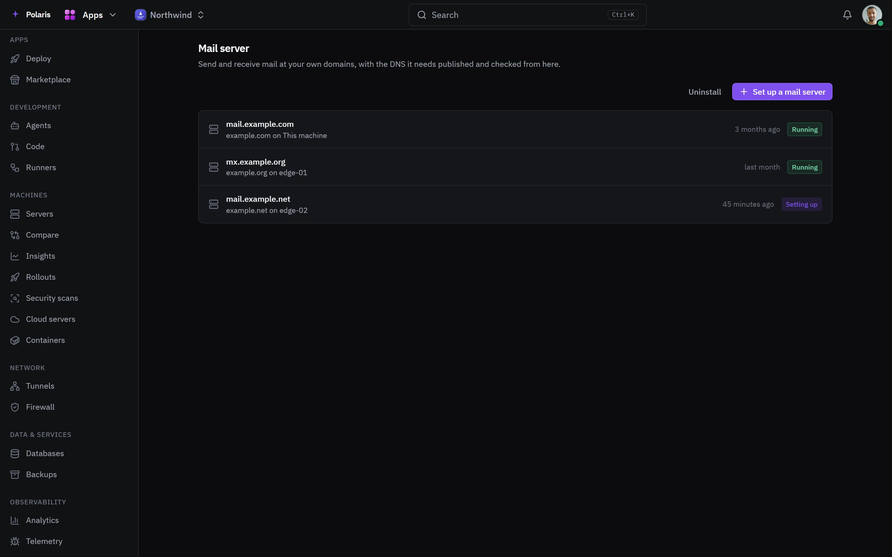
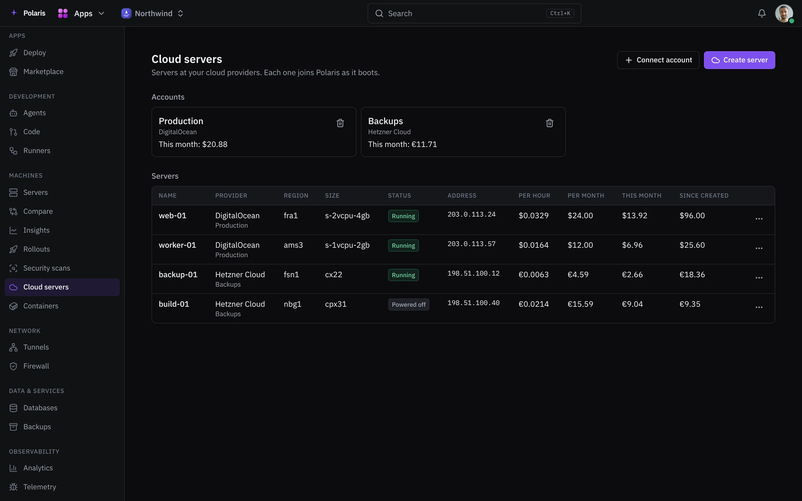
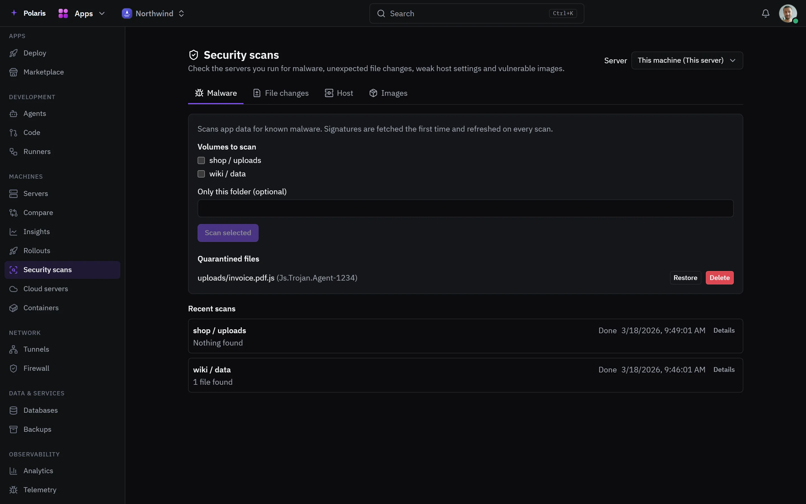
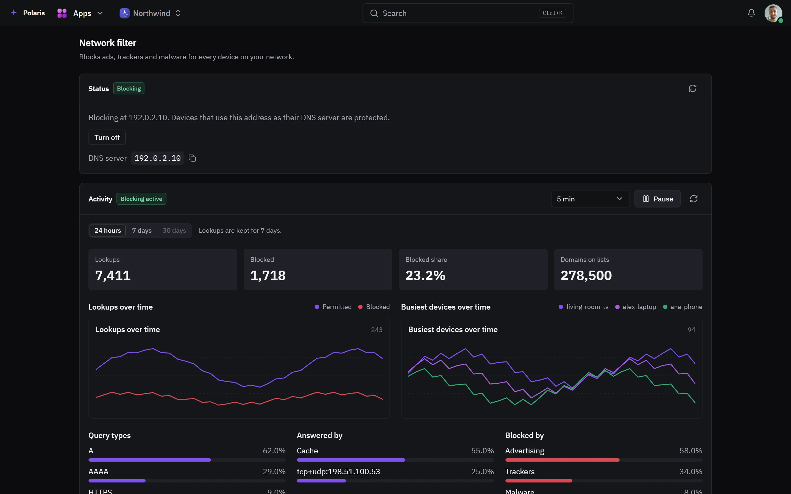

# Marketplace

[Leer en español](marketplace.es.md) - [Back to the README](../../README.md)

The apps Polaris can add, installed with one press: Calendar, CRM, Tools, a
mail server for your own domains, game servers, Places for cameras and smart
devices, and the messaging bridge behind the Inbox.

There are two marketplaces. Polaris's own apps are switched on for everybody
by an administrator, from **Management > Polaris apps**, which also lists
the apps every Polaris comes with - Drive, Chat, Mail, Tasks and the rest -
marked Built in, with nothing to uninstall. **Apps > Marketplace** is for
other developers' software that Polaris deploys and runs for you.

Every picture is the real interface drawn with made-up people and data, and
follows your light or dark setting. Phone-sized versions are in
[docs/assets/media](../assets/media).

## The catalog

<picture>
  <source media="(prefers-color-scheme: light)" srcset="../assets/media/marketplace-light-en-desktop.webp">
  
</picture>

Installed apps sit at the top with their state, and the rest of the catalog by
category below. Most apps run nothing when installed: they switch their screens
on, and download an engine only when somebody first uses it - a game's server
arrives the first time a server of that game is created.

## Installing with choices

<picture>
  <source media="(prefers-color-scheme: light)" srcset="../assets/media/marketplace-install-light-en-desktop.webp">
  
</picture>

An app that runs a container of its own can be installed as it comes, or
configured first: its name, the machine it runs on, and whether each of its
volumes lives on that machine or on a NAS from Drive.

## Each app's own page

Every app in the catalog has a page of its own, like a store listing: its
name, mark and description, what it does, its own screenshots for your theme
and language, and the details its manifest knows - developer, category,
version, image. Install, Configure, Open and Uninstall sit on the page and are
offered only when you are allowed to use them.

Uninstalling deletes the app's data by default - its volumes, settings and
everything made in it, including files such as camera footage - and leaves
nothing behind. Unticking that in the dialog keeps the data for a reinstall
instead; it stays on the server and is listed under Storage, where it can be
freed later.

## Some of the apps it adds

Each one as it looks once installed: Tools, Status pages, Mail server, Cloud
servers, Security scans, CRM and Network filter.

<picture>
  <source media="(prefers-color-scheme: light)" srcset="../assets/media/tools-light-en-desktop.webp">
  
</picture>

<picture>
  <source media="(prefers-color-scheme: light)" srcset="../assets/media/status-pages-light-en-desktop.webp">
  
</picture>

<picture>
  <source media="(prefers-color-scheme: light)" srcset="../assets/media/mail-server-light-en-desktop.webp">
  
</picture>

<picture>
  <source media="(prefers-color-scheme: light)" srcset="../assets/media/cloud-servers-light-en-desktop.webp">
  
</picture>

<picture>
  <source media="(prefers-color-scheme: light)" srcset="../assets/media/security-scans-light-en-desktop.webp">
  
</picture>

<picture>
  <source media="(prefers-color-scheme: light)" srcset="../assets/media/crm-light-en-desktop.webp">
  
</picture>

<picture>
  <source media="(prefers-color-scheme: light)" srcset="../assets/media/network-filter-light-en-desktop.webp">
  
</picture>
