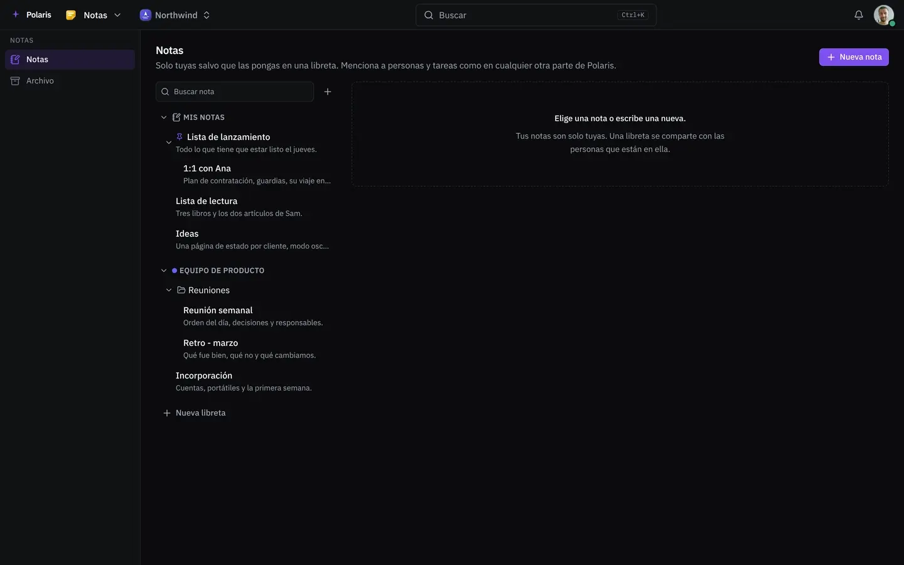

# Notas

[Read in English](notes.md) - [Volver al README](../../README.es.md)

Notas para ti y libretas para tu equipo, escritas con el mismo editor que el
resto de Polaris. Las notas se anidan unas bajo otras, se archivan en carpetas
y se pueden fijar arriba.

Cada imagen es la interfaz real dibujada con personas y datos inventados, y
sigue tu ajuste claro u oscuro. Las versiones para móvil están en
[docs/assets/media](../assets/media).

## Tus notas y las del equipo

<picture>
  <source media="(prefers-color-scheme: light)" srcset="../assets/media/notes-light-es-desktop.webp">
  
</picture>

Títulos, listas de tareas, código y citas se escriben al teclear. Una nota
pasa de tu estantería a una libreta, va al archivo en vez de borrarse y se
descarga en Markdown.
