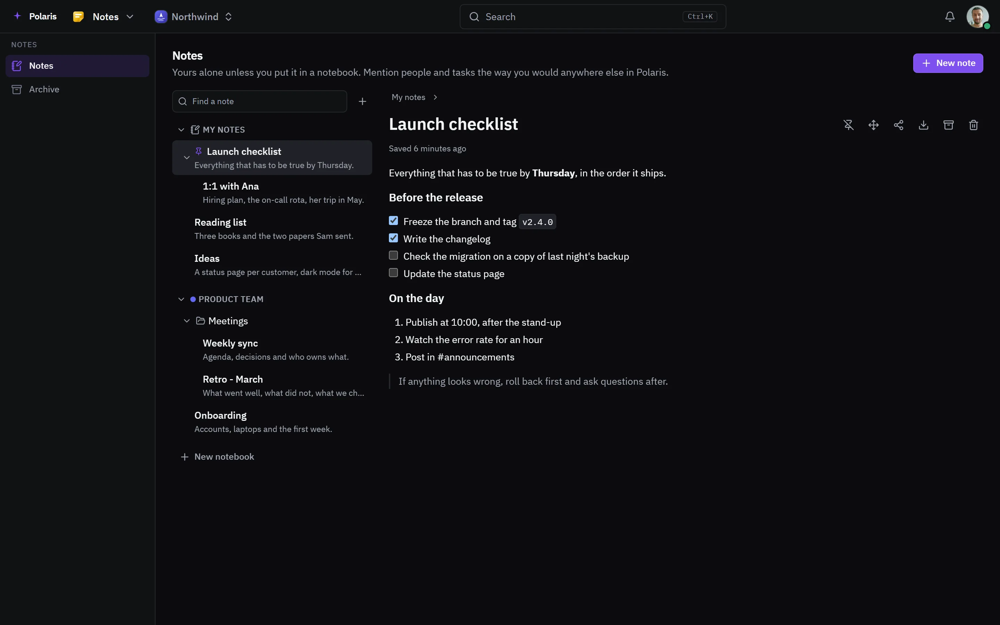

# Notes

[Leer en español](notes.es.md) - [Back to the README](../../README.md)

Notes for yourself and notebooks for your team, written in the same editor as
the rest of Polaris. Notes nest under each other, file into folders and can be
pinned to the top.

Every picture is the real interface drawn with made-up people and data, and
follows your light or dark setting. Phone-sized versions are in
[docs/assets/media](../assets/media).

## Your notes and your team's

<picture>
  <source media="(prefers-color-scheme: light)" srcset="../assets/media/notes-light-en-desktop.webp">
  
</picture>

Headings, checklists, code and quotes are written as you type. A note moves
between your own shelf and a notebook, goes to the archive instead of being
deleted, and downloads as Markdown.
