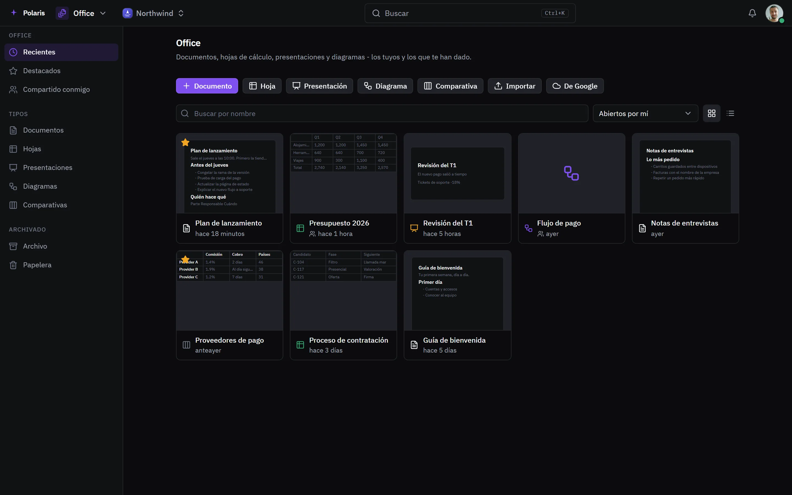
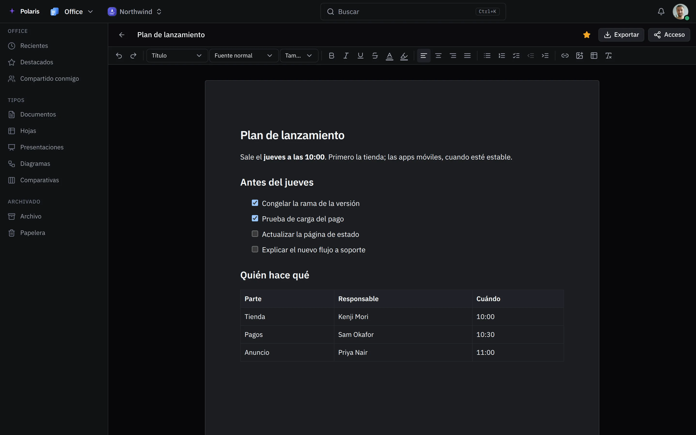

# Office

[Read in English](office.md) - [Volver al README](../../README.es.md)

Documentos, hojas de cálculo, presentaciones, diagramas y comparativas,
guardados en Polaris y editados en equipo.

Cada imagen es la interfaz real dibujada con personas y datos inventados, y
sigue tu ajuste claro u oscuro. Las versiones para móvil están en
[docs/assets/media](../assets/media).

## Tus documentos

<picture>
  <source media="(prefers-color-scheme: light)" srcset="../assets/media/office-light-es-desktop.webp">
  
</picture>

Todo lo que creaste o te pasaron, por tipo, con destacados, compartidos
conmigo, archivo y papelera. Los Google Docs y Sheets se abren aquí como copia,
y el original sigue igual en Google Drive.

El inicio abre una cuadrícula de vistas previas: cada ficha muestra la primera
página, hoja o diapositiva del documento, así que se encuentra por lo que
contiene y no solo por su nombre. La vista de lista está a un clic, para
elegir por nombre, fecha y quién lo tocó; la elección se recuerda para la
próxima vez.

## Editar

<picture>
  <source media="(prefers-color-scheme: light)" srcset="../assets/media/office-doc-light-es-desktop.webp">
  
</picture>

Varias personas editan el mismo documento a la vez y ven los cambios de los
demás mientras se escriben. Los documentos admiten títulos, fuentes, colores,
checklists, tablas e imágenes. Las hojas de cálculo tienen fórmulas y formatos
numéricos. Las presentaciones tienen diseños, temas, gráficos, transiciones y
animaciones, notas del orador y vista de presentador.

## Las apps de Office

Cada tipo se abre en su propio editor. Empieza uno desde el menú de nuevo de
Office, o abre un archivo que ya tengas.

- **Documento** - escribe algo y dale formato: títulos, fuentes, colores,
  listas de tareas, tablas e imágenes.
- **Hoja de cálculo** - números, fórmulas y tablas, con formatos de número.
- **Presentación** - algo que presentar, con diseños, temas, gráficos,
  transiciones y animaciones, notas del orador y vista de presentador.
- **Diagrama** - dibuja cómo encaja todo en un lienzo: rectángulos, rombos,
  elipses, flechas, líneas, dibujo libre, texto, imágenes y marcos, con una
  biblioteca de formas y un puntero láser para presentar.
- **Comparativa** - enfrenta a tus competidores en lo que importa, con las
  pruebas. Pulsa **Añadir competidor** y responde cada criterio con lo que
  viste y dónde comprobarlo; una respuesta que nadie comprobó lo dice. Con dos
  criterios que llevan un número - una nota, un precio, una cantidad - el
  **Mapa** de posicionamiento se dibuja solo, y un competidor sin respuesta se
  queda fuera en vez de colocarse en cero.

## Traer archivos

**Importar** abre un archivo como documento. **Abrir desde Google Drive** trae
Docs y Sheets de Google como copia, y deja el original en Drive tal cual.

## Compartir y exportar

Comparte con una persona, un equipo o un rol como lector, comentarista o
editor, o crea un enlace. Exporta, imprime o guarda como PDF desde el editor.
