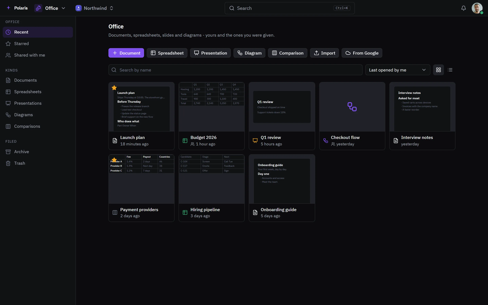
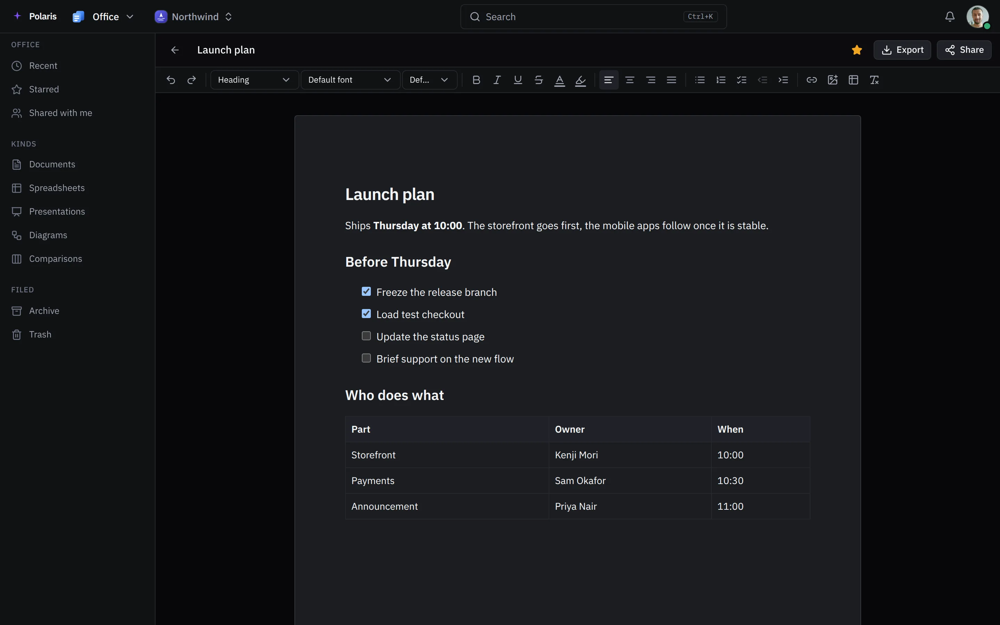

# Office

[Leer en español](office.es.md) - [Back to the README](../../README.md)

Documents, spreadsheets, presentations, diagrams and comparisons, kept in
Polaris and edited together.

Every picture is the real interface drawn with made-up people and data, and
follows your light or dark setting. Phone-sized versions are in
[docs/assets/media](../assets/media).

## Your documents

<picture>
  <source media="(prefers-color-scheme: light)" srcset="../assets/media/office-light-en-desktop.webp">
  
</picture>

Everything you made or were given, by kind, with starred, shared with me,
archive and trash. Google Docs and Sheets open here as a copy, leaving the
original in Google Drive as it was.

Home opens on a grid of previews - each tile shows the document's first page,
sheet or slide, so it is found by what is on it as well as by its name. The
list view is one press away, for picking by name, date and who touched it
last; the choice is remembered for next time.

## Editing

<picture>
  <source media="(prefers-color-scheme: light)" srcset="../assets/media/office-doc-light-en-desktop.webp">
  
</picture>

Several people edit the same document at once and see each other's changes as
they are typed. Documents take headings, fonts, colors, checklists, tables and
images. Spreadsheets have formulas and number formats. Presentations have
layouts, themes, charts, transitions and animations, speaker notes, and a
presenter view.

## The Office apps

Each kind opens in its own editor. Start one from Office's new menu, or open a
file you already have.

- **Document** - write something and lay it out: headings, fonts, colors,
  checklists, tables and images.
- **Spreadsheet** - numbers, formulas and tables, with number formats.
- **Presentation** - something to present, with layouts, themes, charts,
  transitions and animations, speaker notes and a presenter view.
- **Diagram** - draw how it fits together on a canvas: rectangles, diamonds,
  ellipses, arrows, lines, free drawing, text, images and frames, with a shape
  library and a laser pointer for presenting.
- **Comparison** - line competitors up against the things that matter, with the
  evidence. **Add a competitor**, then answer each criterion with what you saw
  and where to check it; an answer nobody checked says so. With two criteria
  that carry a number - a rating, a price, a count - the **Positioning map**
  draws itself, and a competitor without an answer is left off rather than
  placed at zero.

## Bringing files in

**Import** opens a file as a document. **Open from Google Drive** brings Google
Docs and Sheets in as a copy, leaving the original in Drive as it is.

## Sharing and export

Share with a person, a team or a role as viewer, commenter or editor, or make a
link. Export, print or save as PDF from the editor.
