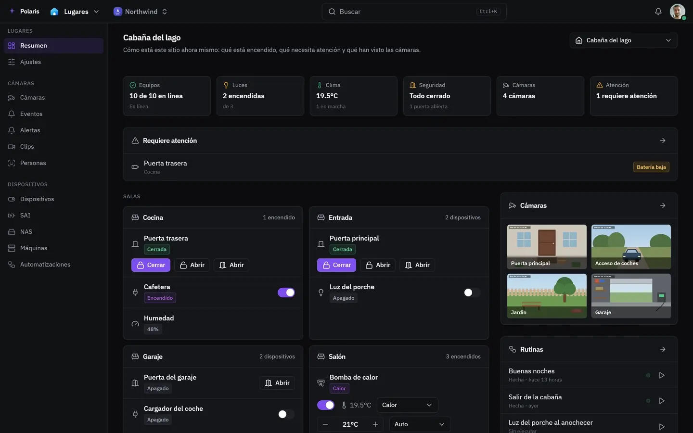

# Lugares

[Read in English](places.md) - [Volver al README](../../README.es.md)

Tus lugares, sus cámaras y sus dispositivos: qué han visto, qué está encendido y
qué hacer al respecto. Un lugar es una casa, una oficina, un taller: cualquier
sitio con cámaras o dispositivos propios.

Cada imagen es la interfaz real dibujada con personas y datos inventados, y
sigue tu ajuste de modo claro u oscuro. Las versiones para móvil están en
[docs/assets/media](../assets/media).

## Un lugar de un vistazo

<picture>
  <source media="(prefers-color-scheme: light)" srcset="../assets/media/places-light-es-desktop.webp">
  
</picture>

**Añadir sitio** desde el selector de lugares: un nombre, qué tipo de lugar es
(casa, oficina, recinto u otro sitio) y, si quieres, una dirección y una ubicación. La
ubicación solo se usa para el amanecer y el atardecer, y se guarda con una
precisión de 1 km aproximadamente. El mismo selector cambia de lugar y comparte
uno con otras personas.

El resumen muestra cómo está el lugar ahora mismo: cuántos dispositivos están
en línea, qué puertas están abiertas, qué te necesita, los dispositivos de cada
sala, las cámaras, las automatizaciones y los últimos eventos. Las
**salas y plantas** se nombran una vez, para que dispositivos y
automatizaciones puedan usarlas.

## Cámaras

Con **Añadir cámara**, Polaris le pregunta qué emite, así que casi todo el
formulario se rellena solo. Las cámaras Tapo, VIGI, Reolink, Hikvision, Dahua y
Amcrest aparecen por marca y modelo; cualquier cámara ONVIF o RTSP también
funciona. **Buscar cámaras** pregunta primero a la red; indica además un rango
de direcciones si las cámaras están detrás de un repetidor o de un punto de
acceso. Una cámara en otra red se alcanza a través de un servidor tuyo que esté
allí, conectado en Servidores.

Para cada cámara eliges qué detecta:

| Opción | Qué hace |
| --- | --- |
| Nada | Verla en directo, y grabar si lo pediste |
| Los avisos de la propia cámara | La cámara decide que algo se movió y se lo dice a Polaris |
| Movimiento | Polaris vigila la imagen pequeña buscando movimiento frente a cómo suele verse |
| Personas, vehículos y animales | Cuando algo se mueve, Polaris dice qué era y en qué parte de la imagen |
| Quién es | Compara caras con las personas que le enseñaste; el resto es un desconocido |

**Dibuja zonas** sobre la imagen: en una zona vigilada solo cuenta lo que pasa
dentro, y una zona ignorada nunca se notifica (la calle, el árbol que se mueve
toda la tarde). Hasta que dibujas una, cuenta toda la imagen. La sensibilidad,
cuánto tiene que durar algo para contar y la pausa entre dos avisos se ajustan
por cámara; **Ajustes** guarda los valores con los que empieza cada cámara
nueva.

La privacidad pone una cámara en *Privada: Polaris no la mira*, o apaga la
propia cámara si lo admite. Los **grupos de cámaras** son conjuntos que eliges
para activar la privacidad en todas a la vez.

## Eventos, clips y avisos

**Eventos** lista todo lo que notaron las cámaras, con la imagen que tomó cada
una. Acótalo a una cámara, una persona o una noche, y abre cualquiera para ver
la grabación de ese momento. Borrar lo que coincide con los filtros elimina las
detecciones y sus imágenes, no las grabaciones.

**Clips** son las grabaciones, de la más reciente a la más antigua. Una cámara
guarda grabaciones cuando se lo indicas en sus propios ajustes. Un clip que
conservas sobrevive al periodo de retención; reprodúcelo, descárgalo o bórralo
desde la lista. Dónde se escriben las grabaciones se decide para toda la
instancia en Subidas.

**Avisos** son las pocas cosas que merece la pena saber. Cada uno indica qué
buscar (una persona, un vehículo, un animal, un paquete, una manipulación, una
cámara que deja de responder), opcionalmente quién, en qué cámara o zona y entre
qué horas. Llega como mensaje en una conversación con las personas que elijas, y
también puede llegar a sus notificaciones.

## Personas y reconocimiento facial

El reconocimiento facial está desactivado hasta que lo activas en **Ajustes**,
donde Polaris instala el reconocedor en el servidor que elijas: unos cientos de
megabytes, una sola vez, y funciona con el procesador sin tarjeta gráfica.
Mientras está desactivado, las cámaras informan de que hay alguien, nunca de
quién.

En **Personas**, añade a cada persona que vive en el lugar con cuatro o cinco
fotografías de su cara, con luz distinta. Las fotografías se quedan en la
máquina donde funciona el reconocedor. Elige de quién enterarte con **Avisar
cuando se vea a ...**; el
resto se notifica como desconocido. Olvidar a una persona borra también sus
fotografías del reconocedor.

## Dispositivos

**Conectar dispositivo** lista lo que Polaris puede alcanzar (enchufes,
interruptores, luces, cerraduras, aires acondicionados, purificadores y más) y
cómo: en tu propia red o desde cualquier sitio. Lo que encuentra llega como
dispositivos que nombras y colocas en una sala. Los pasos de cada marca
están en [Configurar integraciones](../integrations-setup.es.md#dispositivos-de-lugares).

Cada dispositivo muestra su estado y los controles para manejarlo, y su panel
muestra el historial, la batería y el firmware cuando el dispositivo los
informa. Un dispositivo que llega desde una cuenta no tiene lugar, así que
aparece en todos los lugares hasta que lo abres y dices a cuál pertenece.
Conectar dispositivos requiere el permiso de administrar Lugares; el resto ve y
usa lo que está conectado.

## Automatizaciones de dispositivos

Lo que un lugar hace por sí solo: apagar algo pasado un rato, funcionar con un
horario, que un dispositivo siga a otro, cerrar lo que quedó abierto y
avisarte. Añade una con **Crear nueva**, construye sus pasos en el
lienzo y usa **Lanzar ya** para probarla. **Qué hizo** muestra cada
ejecución. Una automatización actúa como quien la guardó por última vez;
cambiarla requiere el permiso de gestionar Lugares.

## Desde un asistente

Un asistente de IA que conectes puede leer el estado de los dispositivos,
manejarlos y ejecutar rutinas si apruebas esos permisos. Nunca se le ofrecen
las cámaras ni las grabaciones. Consulta
[Conectar asistentes de IA](../connecting-ai-assistants.es.md).
