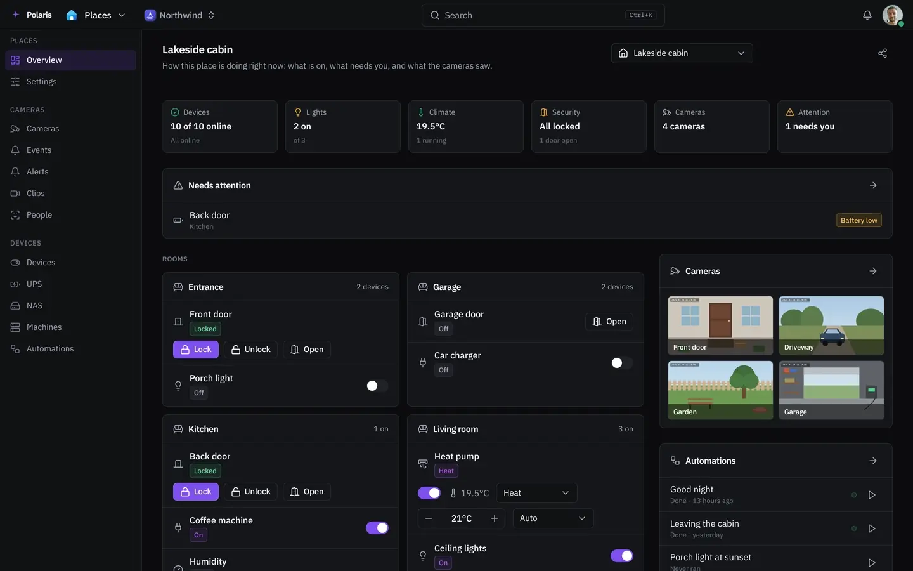

# Places

[Leer en español](places.es.md) - [Back to the README](../../README.md)

Your places, the cameras in them and the devices in them: what they saw, what is
on, and what to do about it. A place is a house, an office, a workshop - anywhere
with cameras or devices of its own.

Every picture is the real interface drawn with made-up people and data, and
follows your light or dark setting. Phone-sized versions are in
[docs/assets/media](../assets/media).

## A place at a glance

<picture>
  <source media="(prefers-color-scheme: light)" srcset="../assets/media/places-light-en-desktop.webp">
  
</picture>

**Add a place** from the place switcher: a name, what kind of place it is
(house, office, site or other), and optionally an address and a location. The
location is only used for sunrise and sunset, and is kept to about 1 km. The
same switcher moves between places and shares one with other people.

The overview shows how the place is doing right now: how many devices are
online, which doors are open, what needs you, each room's devices, the cameras,
the automations and the latest events. **Rooms and floors** are named once, so
devices and automations can use them.

## Cameras

**Add a camera** and Polaris asks it what it streams, so most of the form fills
itself in. Tapo, VIGI, Reolink, Hikvision, Dahua and Amcrest cameras are listed
by brand and model; any ONVIF or RTSP camera works too. **Look for cameras**
asks the network first; give it an address range as well if the cameras sit
behind a repeater or an access point. A camera on another network is reached
through a server of yours that lives there, connected under Servers.

For each camera you choose what it notices:

| Choice | What it does |
| --- | --- |
| Nothing | Watch it live, and record if you asked for that |
| The camera's own alerts | The camera decides something moved and tells Polaris |
| Movement | Polaris watches the small stream for movement against what the view normally looks like |
| People, vehicles and animals | When something moves, Polaris says what it was and where in the picture |
| Who it is | Compares faces against the people you taught it; everybody else is a stranger |

**Draw areas** on the picture: an area to watch means only what happens inside
counts, an area to ignore is never reported (the road, the tree that moves all
afternoon). Until you draw one, the whole picture counts. Sensitivity, how long
something has to last before it counts, and the gap between two reports are set
per camera; **Settings** holds the values every new camera starts with.

Privacy switches a camera to *Private - Polaris is not watching*, or switches
the camera itself off where it supports that. **Sets of cameras** are groups you
pick to switch privacy on all of them at once.

## Events, clips and alerts

**Events** lists everything the cameras noticed, with the picture each one took.
Narrow it to one camera, one person or one night, and open any of it to see the
footage of that moment. Deleting what the filters match removes the detections
and their pictures, not the footage.

**Clips** are recordings, newest first. A camera keeps footage once you tell it
to on its own settings. A clip you keep survives the retention window; play,
download or delete it from the list. Where recordings are written is set for
the whole instance under Uploads.

**Alerts** are the few things worth being told about. Each one says what to look
for (a person, a vehicle, an animal, a package, tampering, a camera going
offline), optionally who, on which camera or area, and between which hours. It
arrives as a message in a conversation with the people you pick, and can also
reach their notifications.

## People and face recognition

Face recognition is off until you turn it on under **Settings**, where Polaris
installs the recognizer on a server you choose: a few hundred megabytes, once,
running on the processor with no graphics card needed. While it is off, cameras
report that somebody is there, never who.

Under **People**, add each person who lives at the place with four or five
photographs of their face, in different light. The photographs stay on the
machine running the recognizer. Pick who to be told about with **Report when
... is seen**; everybody else is reported as a stranger. Forgetting a person
deletes their photographs from the recognizer too.

## Devices

**Connect a device** lists what Polaris can reach - plugs, switches, lights,
locks, air conditioners, purifiers and more - and how: on your own network or
from anywhere. What it finds arrives as devices you name and place in a room.
The steps for each brand are in [Setting up integrations](../integrations-setup.md#places-devices).

Each device shows its state and the controls to work it, and its panel shows
its history, battery and firmware where the device reports them. A device from
an account arrives without a place, so it is listed on every place until you
open it and say which one it belongs to. Connecting devices needs the right to
administer Places; everybody else sees and uses what is connected.

## Device automations

What a place does by itself: switch something off after a while, run on a
schedule, have one device follow another, lock what was left open, and tell you
when. Add one with **New automation**, build its steps on the canvas, and use
**Run now** to try one. **What it did** shows each run. An automation acts as
whoever last saved it; changing one needs the right to manage Places.

## From an assistant

An AI assistant you connect can read device states, operate devices and run
routines when you approve those permissions. Cameras and footage are never
offered to it. See [Connecting AI assistants](../connecting-ai-assistants.md).
