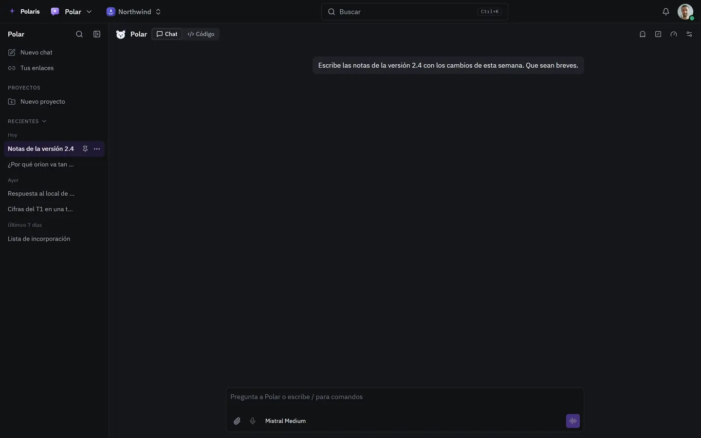

# Polar

[Read in English](polar.md) - [Volver al README](../../README.es.md)

El asistente de Polaris. Pregunta por la página en la que estás y haz cosas
con tu propio acceso, en su propia página o junto a cualquier pantalla.

Cada imagen es la interfaz real dibujada con personas y datos inventados, y
sigue tu ajuste claro u oscuro. Las versiones para móvil están en
[docs/assets/media](../assets/media).

## Un chat propio

<picture>
  <source media="(prefers-color-scheme: light)" srcset="../assets/media/polar-light-es-desktop.webp">
  
</picture>

Los chats anteriores se agrupan por día y se fijan, se guardan en proyectos o
se comparten por enlace. El modelo se elige por chat, se adjuntan archivos y
se puede preguntar en voz alta.
