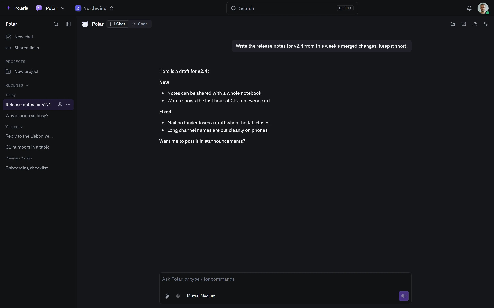

# Polar

[Leer en español](polar.es.md) - [Back to the README](../../README.md)

The assistant built into Polaris. Ask about the page you are on and have
things done with your own access, on a page of its own or beside any screen.

Every picture is the real interface drawn with made-up people and data, and
follows your light or dark setting. Phone-sized versions are in
[docs/assets/media](../assets/media).

## A chat of its own

<picture>
  <source media="(prefers-color-scheme: light)" srcset="../assets/media/polar-light-en-desktop.webp">
  
</picture>

Earlier chats are listed by day and can be pinned, filed into projects or
shared by link. The model is chosen per chat, files can be attached and a
question can be spoken.
