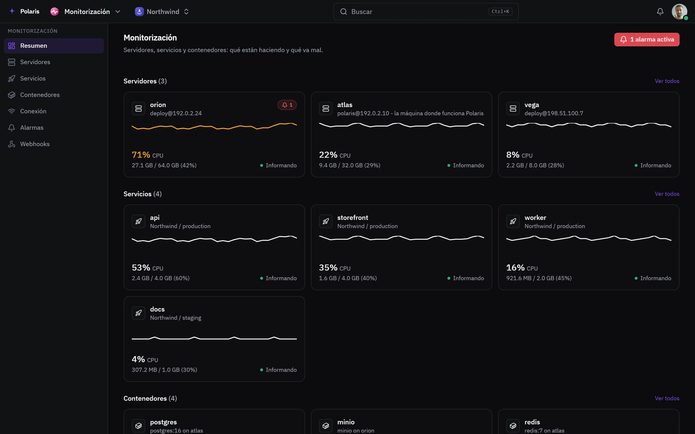

# Monitorización

[Read in English](watch.md) - [Volver al README](../../README.es.md)

Servidores, servicios y contenedores: qué están haciendo y qué va mal, con
alarmas sobre su salud, picos y caídas.

Cada imagen es la interfaz real dibujada con personas y datos inventados, y
sigue tu ajuste claro u oscuro. Las versiones para móvil están en
[docs/assets/media](../assets/media).

## Todo de un vistazo

<picture>
  <source media="(prefers-color-scheme: light)" srcset="../assets/media/watch-light-es-desktop.webp">
  
</picture>

Los más cargados van primero. Cada tarjeta abre el servidor, servicio o
contenedor que hay detrás, y las alarmas, la conectividad y los webhooks
tienen su propia pantalla.
