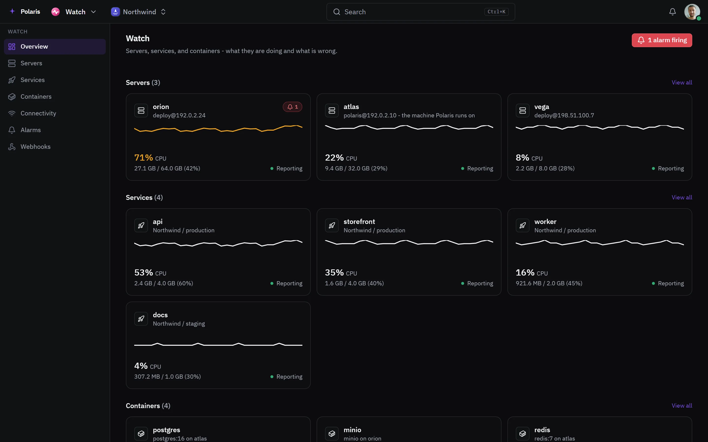

# Watch

[Leer en español](watch.es.md) - [Back to the README](../../README.md)

Servers, services and containers - what they are doing and what is wrong -
with alarms on their health, spikes and outages.

Every picture is the real interface drawn with made-up people and data, and
follows your light or dark setting. Phone-sized versions are in
[docs/assets/media](../assets/media).

## Everything at a glance

<picture>
  <source media="(prefers-color-scheme: light)" srcset="../assets/media/watch-light-en-desktop.webp">
  
</picture>

The busiest come first. Each card opens the server, service or container
behind it, and alarms, connectivity and webhooks each have their own screen.
